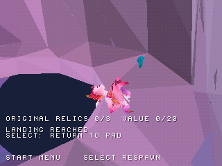

# Zera PS1 Project

Un progetto ambizioso: realizzare un **port completo di Zera da Unity a PlayStation 1**.

*«Nulla è impossibile» — un passo alla volta, verso il gioco completo.*

**Progresso stimato: 29% · WIP09 · In sviluppo**

Personaggio giocabile, animazioni, musica, tre aree di prova, trampolino e raccolta delle reliquie.

### Ultimo progresso

Ripristinati il corpo originale delle reliquie e i colori di base ciano/verde. Raccolta di tutte e tre verificata: **3/3, valore 20/20**.

| Prima | Dopo |
| --- | --- |
|  |  |

Screenshot reali in emulazione. Shader ed effetti riflettenti ancora in lavorazione.

[Scarica il WIP](https://github.com/Dynamon91/Zera-PS1-project/releases/tag/wip09-relic-models-20261029)
