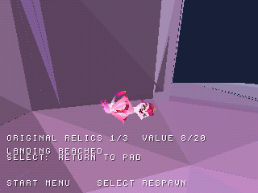

# Zera PS1 Project

Un progetto ambizioso: realizzare un **port completo di Zera da Unity a PlayStation 1**.

*«Nulla è impossibile» — un passo alla volta, verso il gioco completo.*

**Progresso stimato: 29% · WIP09 · In sviluppo**

Attualmente: Zera giocabile con animazioni, musica, tre aree di prova, trampolino e raccolta delle prime reliquie. Il port completo resta l’obiettivo finale.

### Telecamera durante il lancio

| Prima | Dopo |
| --- | --- |
|  |  |

### Raccolta delle reliquie

| Prima della raccolta | Dopo la raccolta |
| --- | --- |
|  |  |

Screenshot reali delle build in emulazione.

[Scarica il WIP](https://github.com/Dynamon91/Zera-PS1-project/releases/tag/wip09-relic-play-50a22b1)
