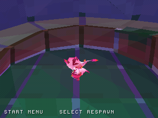
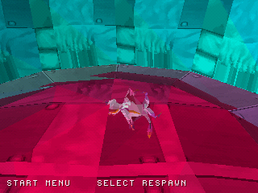

# Zera PS1 adaptation — WIP09 checkpoint

**Estimated full-port completion: approximately 29%.** This provisional weighted
assessment covers the complete game adaptation, not the fraction of exported
assets or elapsed development time. See [PROGRESS.md](PROGRESS.md).

## New: separate original level3 preview

The package now includes a **second playable PS1 disc** for a bounded original
level3 start area. It contains 289 globally clipped source triangles, partitioned
into 543 render triangles. Static-batch submesh selection and scene-space
transforms are recovered and checked against original collider meshes.

| Established level2 start | New level3 start |
| --- | --- |
|  |  |

These real emulator captures show different original areas. The level3 test
walks to (500, 0, 0), finishes grounded and records zero automatic respawns.
This separate terrain preview has no active original collection, enemies,
checkpoints or lava hazards; it is not a full level or a replacement for WIP09.
After extracting the nested native ZIP, open **`build/zera_level3_preview.cue`**
for level3 or **`build/zera_wip09.cue`** for the established level2 build.
[Full level3 evidence, screenshots and limitations](docs/LEVEL3.md).

Level3 now selects support from original collider triangles by player height,
allowing separate floor heights at the same X/Z. The diagnostic heightfield no
longer controls its player support. [Layered-floor checks and limitations](docs/FLOORS.md).

## Latest original-world expansion

The original Windows build's level2 scene was recovered again with its original
transforms. The extraction radius grows from 16 to 32 source units: a 64×64
source-unit square instead of 32×32. That is four times the extraction footprint,
not four times the complete game's playable content. The globally clipped source
patch grows from 591 to 910 triangles, with original Walkable.000 and Walkable.002,
13 original main-texture materials and a 129×129 collision grid at unchanged spacing.

| Previous WIP08 patch | Expanded native patch |
| --- | --- |
|  |  |

The new controller-only exploration run finishes at **(2207, -241, 0)**, grounded
on recovered terrain beyond the old +/-1280 boundary, with no automatic respawn.
The two versions follow the same scripted controller route; their trajectories
and timing diverge, so this is not a frame-matched image-fidelity comparison.
See [full world evidence and provenance](docs/WORLD.md).

Rendering uses 64 resident cells, local draw-distance and whole-cell frustum
checks, plus on-demand shared-vertex classification. Offline subdivision produces
3,588 render triangles; that subdivision is not extra authored content. Collision
uses the unsplit recovered surface. Host tests check cell coverage, conservative
rejection and a route to original ground outside the previous patch. Distant
terrain may pop at cell boundaries; there is no fog or level-data streaming yet.

The exploratory HLE capture observed approximately **13.99 simulation updates/s**
over its active interval. This is scenario-specific emulated simulation pacing,
not a hardware FPS certification. The 30-update target, full original-level flow,
actors, custom shaders, authored progression and hardware validation remain unfinished.

## Current playable features and evidence

| Feature | Current validation |
| --- | --- |
| Jump, glide, boost and terrain/wall movement | Sanitized host checks; native scenario coverage |
| Close-wall camera and stationary side-view fallback | [Actual version comparison](docs/NATIVE_COMPARISON.md) |
| Session audio ON/OFF without stopping the stream | [Recorded PCM and screenshots](docs/AUDIO.md) |
| Terrain-relative fall recovery and view reset | [Input-only native recovery check](docs/RESPAWN.md) |
| Optional six-token trial with simulation timer and best run | [Completion/respawn/restart/title checks](docs/TRIAL.md) |
| Larger original terrain patch | [Grounded exploration outside the old boundary](docs/WORLD.md) |

The optional trial placements, scoring and timing are new PS1 development content,
not recovered original progression. Best time survives trial restarts/respawns and
clears on title/new Explore. Timing uses nominal 30 Hz simulation updates, not wall
clock. Audio settings and records are not saved to memory cards.

## Download, run and resume

The updated `Zera_PS1_WIP09_Source_Checkpoint.zip` shared in this chat contains
current source, assets, tests, actual captures, progress status and per-file
SHA-256 metadata. It also includes **`native/Zera_PS1_WIP09_Native.zip`**: extract
that ZIP, then open **`build/zera_wip09.cue`** with its BIN alongside it to run the
new tested preview. The original `disc/`, `preview/` and `diagnostics/` remain the
WIP08 reference. The nested native artifact records its own built source revision
and binary hash, separately from the current documentation/package revision.

GitHub Actions also publishes a native artifact with the build and real captures,
and a source-only checkpoint after host checks. Artifacts expire after 90 days.
The automatic source-only ZIP omits the optional native artifact; the checkpoint
shared in this chat includes it. Native checks cover the wall camera, audio toggle,
fall recovery, trial lifecycle and baseline/new-world exploration. HLE success does
not establish retail-BIOS, PAL, physical-hardware or full-game compatibility.

After unpacking use `zera_ps1/` as the project root, read PROGRESS.md and run:

```
sh tools/run_host_checks.sh
python3 tools/test_package.py
python3 tools/verify_checkpoint.py /path/to/Zera_PS1_WIP09_Source_Checkpoint.zip
```

To reproduce a source package from a clean checkout:

```
python3 tools/package_wip.py --source-commit "$(git rev-parse HEAD)"
# Optional: add --native-artifact /path/to/downloaded-native-artifact.zip
```

The packager checks the native BIN against its wall/audio evidence and verifies
the PS-X executable header and CUE reference. The original source game Data files
are needed to reproduce scene conversion; they are not bundled as a Unity project.
Use `--radius 32` for current terrain or `--radius 16` for the earlier extraction.
Source-file hashes, mesh IDs, source transforms and conversion limits are recorded
in `reports/world_conversion.json`.

## WIP08 reference implementation details

The following architecture and packaged capture descriptions document the retained
WIP08 baseline. Current source differences and current build evidence are above.

Native PSn00bSDK prototype using the recovered Zera mesh and four original
animation clips. The renderer uses 411 integer vertex positions and 806 triangles.
The original 47-bone rig is evaluated OFFLINE; 65 sampled vertex frames represent
Idle (35), Run (10), Jump (10) and Glide (10). Runtime integer interpolation plays
these frames with clip-specific timing. Clip selection follows player state.
Original vertex colors are averaged per triangle; light modulation is provisional.
Texture overlays are not implemented. Clip switches now blend over six simulation
ticks, starting from the current local pose, including interrupted transitions.
Turning is limited to 128 angle units per simulation tick instead of snapping.
The original Unity transition graph and authored blend settings are not recovered.
Animation pose
conversion is not yet compared against a frame-matched Unity reference.
The checkerboard has been replaced by a bounded patch of the original level2
overworld spawn area: 591 clipped triangles, original vertex colors and ten
original main textures. A 256x256 8-bit indexed atlas holds 64x64 tiles, with
PS1 texture-window commands preserving repeats. Custom Unity shader effects,
far-color textures, transparency and character texture overlays are omitted.
A 65x65 collision heightfield comes from the original walkable collider.
345 conservative wall proxies are derived from steep terrain faces. A vertical
cylinder footprint (radius 24, height 120 world units) resolves horizontal
contact in movement steps no larger than eight units, with sliding at contact.
These are conservative segment/height proxies, not exact capsule/triangle
collision. They may block some space beyond the source triangular surface.
This is a small extracted section, not the full level.
Rendering now clips world polygons against a near plane and guarded view boundaries
before GTE projection, interpolating UVs at new vertices. Shared world vertices
cache their view classifications; trivially visible/invisible triangles bypass
the general clipping path. Character triangles retain conservative GTE rejection
to keep CPU cost down. Extreme close/steep views may still drop character faces. Painter-order artifacts
and affine distortion can still occur; no depth buffer exists.
## Optional pickup trial in WIP08
Normal Explore mode still loads the extracted original spawn patch without
invented source-level pickups. For the separate trial, press Start, choose
`TEST: PICKUP TRIAL` (Up once from Resume), and confirm with Cross. This resets
the player and starts a new six-token run. The on-screen `NEW TEST LAYOUT` label
makes clear that these placements and rules are new PS1 development content.
They are not recovered original placements, rewards, or progression.

The token mesh is recovered from resources.assets object 400 (`Icosphere`),
which is referenced within an original Essence object's hierarchy. It uses a
new gold material and rotating/bobbing display. The original shader is omitted.
Tokens use a horizontal radius check and a vertical tolerance around the player;
collected tokens disappear and cannot score twice. Six pickups show completion.
The pickup sound is the original `_CollectEssence` clip (object 566).

Respawn, including Select and the pause-menu Respawn item, preserves trial
progress. Starting the trial again clears it. Return to Title or beginning a new
Explore session clears the trial. Progress is session-only, with no memory-card
save. Trial updates and token animation freeze while menus are open. The trial
is optional because the original spawn patch had no recovered placed essence
objects; the rest of the source game's collection/progression systems remain
unported. See reports/pickup_conversion.json for mesh and layout provenance.

## Audio inherited from WIP07
The original `cosmic_core` track plays from disc through a 64 KiB RAM ring buffer
and 8 KiB of SPU double buffering. It is the full source track, downmixed to mono
22.05 kHz and encoded as SPU ADPCM. `assets/audio/MUSIC.VAG` contains the encoded
track; it is an ordinary data file on the disc. Track restart is from the beginning
with padding to a stream chunk boundary, not an authored seamless loop.
Seven original effects are resident in SPU RAM: UI navigation/accept, jump, landing,
dash, flap (on entering glide), and pickup. Voices 1-8 rotate for effects; voice 0 streams
music. Music continues through menus at a lower volume. The packaged WIP08 disc has no audio setting. Current native source adds the
session-only AUDIO toggle described above; persistent volume settings remain pending.

The stream driver `src/stream.c` and `src/stream.h` are copied from PSn00bSDK's
MPL-2.0 cdstream example; `audio.c` adapts its disc feed pattern. Effects live above
0x6000 in SPU RAM, separate from streaming buffers and the dummy sample. Runtime
buffer underruns, CD errors, file wraps and effect counters are recorded by the
capture helper. This prototype does not arbitrate CD reads with future level
streaming; its current environment is resident.

This is not a completed conversion of the original game.

## Run the packaged WIP08 reference
The build opens on a native title menu. Cross or Start selects the highlighted
entry; Up/Down changes the selection. Explore starts the extracted spawn section.
Controls opens the controller reference. Diagnostics toggles the in-game debug HUD
for this session; it is off by default and is not saved to a memory card.

Open `disc/zera_wip08.cue` in a PS1 emulator. Keep the BIN alongside it.
`disc/zera.exe` is also provided for development executable loaders. Music needs
the mounted disc image and MUSIC.VAG; executable-only loading may have effects
but cannot supply the music stream. Use the CUE for normal testing.
This exact BIN/CUE was cold-booted in PCSX-ReARMed using its HLE BIOS, interpreter
CPU and software GPU. Original retail BIOS, PCSX-Redux and real PS1 hardware
have NOT been tested. HLE testing alone does not prove retail BIOS compatibility.
Release-mode native build. NTSC output, two-VBlank pacing targeting
30 updates/second when within budget;
no frame-rate guarantee. PAL support and hardware profiling remain pending.

## Controls
D-pad or left stick: move. Cross: jump; hold during descent to glide.
R1: movement boost for eight simulation ticks. L2/R2: rotate arena camera.
L1: restore zero camera angle. Start: open the pause menu. Select: quick respawn.
Pause choices: Resume, Respawn, Controls, Return to Title, Diagnostics, and
Test: Pickup Trial. Circle
or Start resumes from pause; Cross chooses a menu item. Movement and animation
freeze in the title, pause and controls screens. Menu accept does not pass through
as a jump; resets restore camera, character facing and animation. A quick respawn
also restores the default orbit angle.
Analog mode may be selected manually; rumble/automatic configuration absent.
Movement is camera-relative, the camera follows horizontal player position,
and the character turns to the selected movement direction. Collision follows terrain height and slopes, rejects rises above 48 units,
allows ledge falls. The WIP08 reference disc respawns 700 units below spawn;
the current native preview instead uses the terrain-derived plane described above.
The packaged WIP08 camera follows horizontal position and eases toward player height.
Its view path is tested against wall proxies: it retracts immediately and
extends gradually. The minimum distance is 420 units to keep the character
readable; this can override the nearest obstruction. Tight corners can therefore
still obscure geometry. Camera sphere/ceiling tests and alternative orbit
selection are not implemented.
Heightfield collision cannot represent caves or overlapping walkable surfaces;
steep terrain faces use conservative wall proxies, and mesh-vs-heightfield
agreement near edges and cliffs is approximate. Actor/prop colliders are absent. Missing terrain outside the chunk falls
away; it is not an invisible rectangular boundary.

## Screenshots
The packaged preview uses tools/scenarios/pickup_preview.json to open the
optional trial and collect all six. It is new test content. Normal Explore
remains separate. The MP4 records this actual emulator run with SPU audio.
`preview/frame_*.png` are raw 320x240 emulator video outputs from this disc.
`preview/Zera_PS1_WIP08_preview.png` is an exact 3x nearest-neighbor enlargement
of the captured trial-completion frame. No image synthesis, redrawing or mockup is involved.
These are actual decoded clips, with sampled playback and six-tick runtime blending.
`preview/gameplay.gif` records the same scripted emulator session at four-frame
intervals. GIF playback timing is approximate, not a hardware performance measure.
The default capture script selects Explore from title, feeds right movement,
then holds Cross through the
descent (frame 405 through 604); screenshots record
initial state, moved position, jump, glide and eventual return to the floor.

## Build
Install PSn00bSDK 0.24, its GCC MIPS toolchain, CMake >=3.21 and Ninja.
Set PATH to their tool directories and PSN00BSDK_LIBS to lib/libpsn00b:

```
cmake --preset default . -DCMAKE_BUILD_TYPE=Release
cmake --build build
```

If GCC is separate, pass `-DPSN00BSDK_TC=/path/to/toolchain` at configuration.
Current source outputs include build/zera.exe, zera.elf, zera.map and zera_wip09.bin/.cue.
The bundled WIP08 disc in disc/ is retained separately.
SDK/toolchain binaries and generated CMake caches are not bundled.

## Reproduce audio conversion
The original upload contains the source clips; the full decoded music WAV is
excluded from this checkpoint to avoid duplicating a large recoverable file.
The seven short source WAVs are included. With an extracted Unity Data directory:

```
python tools/extract_audio.py /path/to/Data
cc -O3 -Wall -Wextra -Werror tools/encode_spu.c -o /tmp/encode_spu
python tools/convert_audio.py /tmp/encode_spu
python tools/check_audio.py
```

FFmpeg is needed for PCM conversion; a host C compiler builds the ADPCM encoder.
The encoder searches predictor/shift combinations for each 28-sample block and
pads DMA samples and music chunks separately. Offline decode checks measured
27-38 dB signal-to-quantization-noise ratio for these assets. This is a codec
check, not a listening-quality guarantee. Source identities are recorded in
reports/audio_sources.json. Rebuilding with converted audio regenerates the disc.

## Reproduce recovery and conversion
Install requirements.txt. Supply the extracted Unity Data directory:

```
python tools/audit_unity.py /path/to/Data reports
python tools/export_meshes.py /path/to/Data assets/recovered_meshes
python tools/convert_character.py
python tools/bake_animation.py /path/to/Data
python tools/convert_world.py /path/to/Data --radius 32
python tools/convert_pickup.py /path/to/Data
```

The color sidecar `assets/zera_vertex_colors.json` contains original per-vertex
colors recovered through UnityPy MeshHandler from resources.assets object 314.
The converter uses the recovered OBJ and this sidecar; no Unity installation
is needed to regenerate src/zera_mesh.h from the included inputs.
The animation baker additionally reads original Unity Data files. It recovers
transform path CRC bindings, streamed cubic curves, constants and dense samples,
evaluates hierarchy matrices and linear blend skinning, then quantizes vertices.
`assets/character_animation_source.json` preserves relevant rig/curve data;
`reports/animation_conversion.json` records the sample counts and limitations.
Baking currently requires UnityPy, NumPy and SciPy; it is not a Unity runtime.
The world converter evaluates original scene transforms, clips the spawn patch,
preserves interpolated UVs at the patch boundary, builds an indexed atlas, and
samples the source walkable collision triangles. See world_conversion.json and
assets/world_chunk_source.json. Mesh index/color/texture data retain provenance;
no new environment geometry was invented.

Inventory: 788 Mesh, 240 Texture2D, 164 AnimationClip and 97 AudioClip objects.
These are serialized object counts, not necessarily unique gameplay assets.
786 meshes exported to OBJ; two yielded no usable geometry, recorded in the
export manifest. Metadata includes assembly member names, not decompiled code.
OBJ assets are raw geometry for future reduction, not complete rigged scenes.

## Reproduce the emulator capture
Build the PCSX-ReARMed libretro core from https://github.com/libretro/pcsx_rearmed
(commit c881679 used here) with:

```
make -f Makefile.libretro -j4 platform=unix DYNAREC=0 HAVE_CHD=0
python tools/capture_libretro.py /path/to/pcsx_rearmed_libretro.so disc/zera_wip08.cue preview
```

The capture helper uses ctypes, Pillow and NumPy; no graphical desktop is
required. It explicitly selects HLE BIOS. No retail BIOS or emulator binary
is bundled. Headless capture is a smoke test, not exhaustive emulation validation.
The default capture also records raw stereo SPU output to audio.wav and a GIF of sampled
video frames. After the capture process exits, run:

```
python tools/make_capture_movie.py preview
```

This separate process creates gameplay.mp4 with the captured audio and checks
both streams and the duration. It uses the actual video samples from emulator
frame 300 onward at 15 Hz, with the corresponding audio starting five seconds
into the capture. It is a sampled preview, not a frame-rate measurement. The silent GIF has no audio. WAV data is finalized
after emulation and its byte count is checked. A scenario can select a late audio
excerpt with audio_start_frame or disable audio/movie output.
An optional fourth argument selects a JSON scenario with frame count, buttons
and screenshot checkpoints. The helper reads player/camera state only through
the emulator system-RAM API, resolving offsets from the matching zera.map.
To replay the sustained wall test, append tools/scenarios/wall_walk.json to the
capture command and select a separate output directory.

## Verified / pending
The following native build and emulator results describe the packaged WIP08 disc.
Post-WIP08 source validation is listed above and in PROGRESS.md.

Passed: warning-free native compile/link and disc authoring, host movement
unit checks with address/undefined-behavior sanitizers, PS-X EXE load range,
raw-sector/ISO9660/boot records, ZIP integrity, HLE cold boot and scripted
movement/jump/glide video capture with original clip playback.
The updated host tests also check movement basis rotation by 90 degrees,
slope height following, high-step rejection and ledge fall/respawn.
The real generated heightfield is checked at the source spawn and outside bounds.
Audio checks cover known ADPCM nibble decoding, encoded block flags, tone quality,
stream header/size and SPU allocation. A 13,000-frame emulator run traversed a full
music repeat with zero reported underruns and CD errors. Its late audio excerpt
correlates with the beginning of the original track after restart. The gameplay
and menu runs record actual audio, and an effect scenario triggers the first six sounds; the trial scenario verifies the seventh pickup sound.
These are emulator results; optical-drive timing and sound hardware are untested.
Run `sh tools/run_host_checks.sh` on a host with GCC/Clang sanitizer support.
The trial checks cover one-shot collection, height rejection, large coordinates,
pause freeze, completion and reset. The trial emulator scenario completes all six,
respawns without losing progress, restarts a fresh run and returns to title.
The capture helper can stop only movement input when completion is observed via
read-only emulator state; it never edits game RAM. The pickup preview uses this
feedback so it stops at completion rather than continuing into a wall.
New ASan/UBSan menu/animator checks cover navigation and return paths, pose
freeze during pause, interrupted transitions, blend completion and jump-frame
clamping. A 1,800-emulator-frame menu scenario verifies controls from both title
and pause, movement/animation freeze, respawn, return to title and diagnostics.
See diagnostics/menu_flow and tools/scenarios/menu_flow.json.
New ASan/UBSan checks also cover wall sidedness/sliding/height intervals, ray crossing,
near/view clipping and UV ranges, and 1,000 steps into the actual wall proxies.
A separate 1,600-emulator-frame scenario holds movement against the wall, pauses
while opposite movement is held, resumes, retreats, and manually respawns.
Emulator RAM samples confirm pause/retreat/respawn and camera-distance changes.
See diagnostics/wall_walk and tools/scenarios/wall_walk.json. LeakSanitizer is disabled due to runner limits.
Not verified: physical hardware, retail BIOS, analog controller, every button,
stress/load timing, memory cards, optical-drive streaming, full original-world progression.

Next: validate the extracted room and animation against original Unity footage;
expand environment visibility, refine wall proxies and tight-corner camera behavior;
refine transitions and add character overlays and interaction; then level-data streaming, saving and physical-hardware validation.

## Attribution
Original recovered game content remains attributable to its creators.
Render context functions in src/main.c derive from the PSn00bSDK template by
Lameguy64 and spicyjpeg under MPL-2.0; retain its source header and included
PSn00bSDK_LICENSE.md. The external SDK/toolchain/emulator binaries are not bundled; the attributed
streaming helper sources are included under their original license.

Clipping optimization: [measured before/after results](docs/PERFORMANCE.md).

Original progression source recovery: [193 relics, 20 essences and 13 checkpoints with original transforms](docs/ORIGINAL_PROGRESSION.md). This is recovered conversion data; the playable runtime is unchanged.
