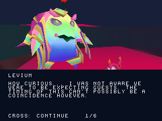

# Zera PS1 Project

Port in sviluppo di **Zera Myths Awaken** da Unity a PlayStation 1.
Il riferimento è la build Windows **5.2 pre-release 5** fornita per il progetto.
L'obiettivo è il gioco completo: livelli, menu, sequenze, personaggi,
interazioni, modelli, animazioni, musiche, effetti e salvataggi.

**WIP09 · In sviluppo · Stima precedente del 29%, provvisoria e non ricalcolata.**

### Ultimo progresso

Primo incontro con **Levium in Cosmic Core**: modello originale, sei battute,
frase successiva, avvicinamento al punto di conversazione, pausa e ripresa.
Respawn conserva l'incontro; Nuova partita lo azzera. Levium usa ancora la posa
statica originale: le animazioni Idle/Talking sono il prossimo lavoro.



[Scarica l'ultima build verificata e i sorgenti autonomi](https://github.com/Dynamon91/Zera-PS1-project/raw/refs/heads/main/dist/Zera_PS1_WIP09_Levium_dialogo_originale.zip) ·
[Preview in gioco](docs/screenshots/levium/conversation.gif) ·
[Prove e limiti della milestone](docs/LEVIUM_DIALOGUE.md)

Aprire `build/zera_campaign.cue` del pacchetto per Cosmic Core. La precedente
preview di Dreary Valley, con due reliquie e checkpoint, è inclusa separatamente
come `build/zera_gameplay.cue`. Le scene non sono ancora collegate dalla
progressione originale.

### Lavoro già integrato

- Logo originale con sonoro, titolo, musica Glass Arp e menu con pausa/ripresa.
- Crediti e changelog originali, volumi separati e impostazioni della camera.
- Primi percorsi giocabili in Cosmic Core e Dreary Valley con collider originali
  e caricamento a settori; geometria statica delle sei scene del mondo nell'atlante.
- Scheletro di Zera corretto, animazioni e materiali recuperati; controlli sugli
  asset per evitare modifiche involontarie ai modelli già verificati.
- Primo dialogo originale con Levium e precedenti preview di trampolino,
  raccolte e checkpoint.

[Stato del progetto e prossimi passi](PROGRESS.md) ·
[Obiettivo del port completo](docs/PORT_COMPLETO.md) ·
[Rapporto di verifica di Levium](reports/levium_validation.json)

Le prove sono locali con PCSX-ReARMed HLE. Il gioco completo, le animazioni di
Levium, gli altri NPC, la musica dei livelli nella nuova build, le transizioni
tra scene e la memory card restano in lavorazione. Nessuna certificazione su
hardware PS1 è dichiarata.

### Ricompilazione

Con PSn00bSDK 0.24 e `PSN00BSDK_LIBS` configurati:

```sh
sh tools/run_host_checks.sh
cmake --preset default -DCMAKE_BUILD_TYPE=Release -DZERA_CAMPAIGN_ENTRY=ON -DZERA_LEVIUM_DIALOGUE=ON
cmake --build build --target iso_campaign
```

Nel pacchetto ZIP sono incluse istruzioni specifiche per il sorgente autonomo.

**Prossima milestone:** animazioni originali Idle/Talking di Levium, con controlli
su rig, materiali e resa in gioco.
