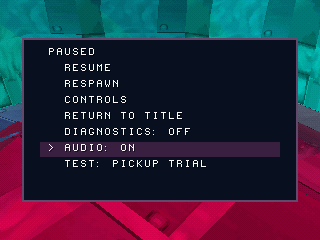

# Audio on/off — native verification

Source: `0c8e4c27657922a787963efbc07f79f7fa92c131`. Build hash: `c0d5e312ab287e79193365655bb961a4454ab2d04cf8930c45af17ce4e918039`.

| Muted | Restored |
| --- | --- |
|  |  |

Captured PCM RMS: muted **0.000**, restored **709.557** (signed 16-bit amplitude).
Music remained initialized and disc refills continued during the test.
The setting persists for this session through respawn and return to title;
it is not a memory-card setting. This is an emulator check, not hardware validation.
The source ZIP retains its labeled WIP08 disc; the new playable build is in the
corresponding Native PS1 preview artifact.
