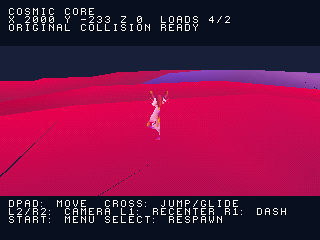
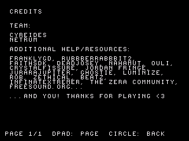
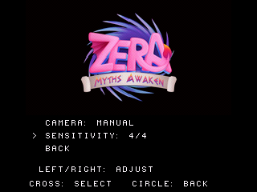

# Menu originale e ingresso giocabile a Cosmic Core

Questa pagina descrive la milestone precedente. Il primo incontro con Levium
è documentato in [LEVIUM_DIALOGUE.md](LEVIUM_DIALOGUE.md).

Il nuovo disco `zera_campaign.cue` collega **Play a Cosmic Core**, nello spawn
originale dell'area Tutorial della scena `level2`. Logo iniziale, sonoro e musica
del titolo restano integrati. La precedente camminata in Dreary Valley rimane
nel disco separato `zera_gameplay.cue`: i passaggi tra le due scene devono ancora
essere collegati secondo la progressione originale.



[Camminata e caricamento dei settori](screenshots/campaign/walking.gif) ·
[Salto e attraversamento del confine di settore](screenshots/campaign/airborne.gif)

## Menu e impostazioni

I 65 componenti UI.Text della scena originale Main Menu sono stati recuperati
con offset nel contenuto serializzato e hash sorgente. Crediti e changelog
conservano tutto il testo recuperato, adattato al font PS1: **una pagina di
crediti e 71 pagine di note storiche**. I nomi e i ringraziamenti sono originali.
Le note storiche non descrivono le funzioni attualmente implementate nel port.



Il titolo offre Play, Options, Controls, View Credits e Changelog. In Credits
e Changelog, D-pad o Cross cambiano pagina; Cerchio torna al titolo.

Options contiene:

- Sound On/Off, che silenzia o riattiva l'uscita audio generale;
- Audio: volumi indipendenti Music e Sound Effects, da 0 a 4;
- Gameplay: Camera Automatic/Manual e sensibilità da 1 a 4;
- Back, per tornare al titolo o alla pausa da cui si è entrati.

Sinistra/Destra regolano i valori. Le impostazioni agiscono sul volume delle
voci SPU e sulla camera: Manual disabilita la rotazione automatica di recupero,
mentre L2/R2 continuano a ruotare la camera con la sensibilità scelta. L1 ricentra
alla direzione dello spawn originale. Le impostazioni durano nella sessione,
anche tornando al titolo e iniziando una nuova partita.



Start apre la pausa; Resume, Start o Cerchio riprendono. Respawn ritorna allo
spawn di Cosmic Core. In pausa e nei relativi sottomenu restano fermi posizione,
velocità, animazione e simulazione. Nuova partita ripristina lo spawn, senza
cambiare le impostazioni. Salvataggi, opzioni video, costumi, regolazioni delle
voci e altre schermate originali non sono ancora riprodotti: non sono presentati
come comandi funzionanti.

## Terreno e modello

Sono stati recuperati **21.935 triangoli di MeshCollider originali attivi**, in
**548 settori**. La finestra fisica contiene al massimo 5.149 triangoli; il buffer
ha capacità 5.376. La banca grafica dell'atlante usa la stessa origine sorgente:
`(-26.5100002, 21.8589993, 9.2319994)`. Fisica a scala 80 e grafica a scala 40.

Il percorso provato va dallo spawn a `(2000,-233,0)`, con attraversamento del
confine X=1280 anche durante salto/planata e atterraggio sul terreno originale.
Select ritorna allo spawn, a `(0,2,0)` dopo l'assestamento. La direzione iniziale
della camera è yaw 3072; il personaggio parte orientato secondo la stessa
convenzione usata dal movimento, senza una correzione improvvisa al primo passo.

Mesh, animazioni, materiali e texture del personaggio restano quelli già
corretti. Il controllo sui sette file di riferimento resta attivo. Le reliquie
e il checkpoint di Dreary Valley sono disabilitati nella scena Cosmic Core,
così le loro coordinate non generano oggetti o raccolte nel livello sbagliato.

## Prove locali

- Provenienza dei collider controllata sui file originali: hash, trasformazioni,
  stato attivo, mesh e conteggi dei triangoli. Il recupero preesistente di
  Dreary Valley rimane identico byte per byte dopo la generalizzazione dello strumento.
- Test host con ASan/UBSan: terreno di Cosmic Core, passaggio in aria tra settori,
  atterraggio, ripristino dopo lettura fallita, paginazione e limiti dei valori del menu.
- Quattro scenari nativi su `zera_campaign`: terreno, salto/planata, salto durante
  il cambio settore e navigazione di crediti/changelog/audio/camera/pausa/titolo.
- Otto regressioni native sul disco Dreary Valley: avvio, menu, salto del logo,
  quattro prove di movimento e percorso di reliquie/checkpoint.
- Il silenzio con Music=0 e il ritorno del suono con Music=4 sono verificati
  sul PCM registrato; la pausa conserva posizione, velocità e contatori animazione.
- Build Release: 1.454.152 byte di sezioni statiche, entro il budget di 1.572.864.
  Questo dato non certifica frame rate o funzionamento su hardware reale.

Risultati, hash e limiti: `reports/campaign_entry_validation.json`.
Le prove native sono locali con PCSX-ReARMed HLE. Il workflow GitHub è aggiornato;
non è stato avviato da remoto.

## Lavoro rimanente

È verificato il primo percorso, non l'intera scena o la campagna. Non sono ancora
riprodotti dialoghi/NPC, la sequenza narrativa del tutorial, abilità e oggetti
originali necessari alla progressione, raccolte/checkpoint di Cosmic Core,
trampolini, danni, acqua, portali e transizioni tra livelli. I collider convex
usano le mesh sorgenti senza il cooking Unity; Box/SphereCollider e movimenti
runtime non sono integrati. Texture/shader del mondo restano adattati e incompleti.

La musica del titolo e gli effetti già convertiti funzionano; la musica di Cosmic
Core non è ancora collegata a questo disco. Memory card e completamento globale
restano da implementare. [Piano del port completo](PORT_COMPLETO.md).

**Prossima milestone:** primi dialoghi e interazioni originali del tutorial di
Cosmic Core, con progressione verso l'hub.

## Rigenerazione e build

```sh
python3 tools/recover_frontend_ui.py '/percorso/Zera Myths Awaken_Data' --check
python3 tools/check_frontend_ui.py
python3 tools/check_stream_collision.py --area previews/cosmic --data '/percorso/Zera Myths Awaken_Data'
sh tools/run_host_checks.sh
cmake -S . -B build -DCMAKE_BUILD_TYPE=Release -DZERA_CAMPAIGN_ENTRY=ON
cmake --build build --target iso_campaign
python3 tools/capture_libretro.py /percorso/pcsx_rearmed_libretro.so build/zera_campaign.cue build/campaign_ui tools/scenarios/campaign_ui.json
python3 tools/check_campaign_capture.py build/campaign_ui --kind ui
```

La banca dei collider si rigenera con `tools/recover_stream_collision.py DATA
--scene level2 --output previews/cosmic`; i dati già convertiti sono inclusi nel
pacchetto autonomo. Per le altre banche e il logo vedere la milestone di
[avvio integrato](FRONTEND.md).
