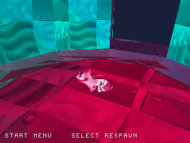

# Correzione del personaggio — WIP09

**Aggiornamento:** questo primo intervento sul rendering non risolveva la
deformazione dello scheletro. La correzione successiva delle rotazioni e le
nuove catture sono in [CHARACTER_RIG_FIX.md](CHARACTER_RIG_FIX.md).

Il renderer disegnava anche le facce interne del personaggio e usava l'ordine
statico dei materiali per triangoli che finivano nello stesso intervallo della
tabella di profondità PS1. Questo produceva superfici sovrapposte e dettagli
coperti, dando al modello un aspetto frammentato.

Ora vengono escluse le facce rivolte verso l'interno della vista e quelle
proiettate di taglio. I triangoli rimasti vengono ordinati con la profondità GTE
precisa all'interno di ogni intervallo; a parità di profondità, occhi e macchie
mantengono la priorità sulla pelle. La correzione è presente nei quattro dischi.
Il modello originale conserva 412 vertici, 806 triangoli e quattro animazioni.

| Prima | Dopo |
| --- | --- |
|  |  |

Sono screenshot reali dell'emulatore con lo stesso scenario di input. Il costo
di rendering cambia il tempo di simulazione raggiunto al singolo fotogramma:
le pose non costituiscono un confronto sincronizzato con l'originale Unity.

[Preview in gioco](screenshots/character_model/gameplay.gif) ·
[Personaggio nel percorso checkpoint](screenshots/character_model/checkpoint.png)

La GIF contiene fotogrammi consecutivi dell'emulatore, dal frame video 1200
al 1596 campionato ogni quattro frame e ingrandito senza interpolazione.

Verifiche locali: suite host con AddressSanitizer/UndefinedBehaviorSanitizer,
scenario personaggio di 2200 frame con Idle/Run/Jump/Glide, muro inclinato,
trampolino, checkpoint separato e percorso continuo con due reliquie e checkpoint.
Il percorso conserva valore 17 dopo Select e Respawn e lo azzera al titolo.
Nel test del checkpoint separato il movimento di allontanamento è stato esteso
di 20 frame per superare con margine il raggio di attivazione; il controllo
di distanza resta invariato.

[Provenienza delle build e risultati](../reports/character_model_validation.json).
Le prove sono locali con PCSX-ReARMed HLE; non certificano prestazioni hardware.
L'ordinamento dei triangoli resta un'approssimazione senza Z-buffer. Shader,
trasparenza morbida degli occhi e transizioni originali restano incompleti.
Il confronto visivo con il gioco Unity originale è ancora da eseguire.
Il completamento complessivo resta stimato al 29%.

**Prossima milestone:** recuperare e visualizzare la pianta originale del
checkpoint nell'area collegata, prima dell'interazione con Kiwi.
