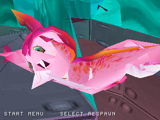

# Playable mascot orientation and blocked movement

Two character behaviors are corrected in both PS1 discs:

- Facing uses the same camera yaw that produced the current movement command.
  Rotating or recentering the view later in that update no longer changes the
  character's intended world heading for movement that already happened.
- Ground locomotion animation uses actual horizontal displacement. Holding a
  direction against an obstruction no longer keeps the Run clip active once
  the player stops. Sliding movement still uses Run; airborne states keep the
  Jump/Glide clip selection.

Turning still advances at most 128 angle units per active update, using the
shortest direction across the 4096-unit full turn. Pause freezes orientation
and animation. An automatic respawn preserves the reset-facing state for that
update. These changes do not alter movement speed, jump tuning or collision data.

| Previously running against the wall | Now idle at the obstruction |
| --- | --- |
|  |  |

Actual emulator screenshots at video frame 1300 have identical player position
and camera values: **X=567, Z=773**, with Right still held. Before, the animation
clip is Run (1); after, actual movement is zero and the clip is Idle (0).
These captures predate the [close-camera presentation guard](CLOSE_CAMERA.md),
which now clears the inside-mascot view at this obstruction.
[Full samples and binary hashes](screenshots/character_motion/verification.json).

The native mascot scenario now rotates the camera while moving. It records
**3 samples** converged to the movement-yaw heading, plus **5 samples** idle at
an obstruction in the wall scenario. The same run covers Idle, Run, Jump and
Glide and finishes grounded with no automatic respawn. All established native
terrain, camera, audio, respawn and optional trial checks pass.
[Native workflow](https://github.com/Dynamon91/Zera-PS1-project/actions/runs/40752870106).

Host checks cover 8 input directions × 16 camera headings, convergence, wrap
across zero, 128-unit turn limits, paused/no-input preservation, recenter-yaw
consistency and ground/air animation choices, under address/undefined-behavior
sanitizers. Native source: `0c8e4c27657922a787963efbc07f79f7fa92c131`.

The original Zera materials and the 412-position, 806-triangle animated mascot
remain in both discs. Full-port completion remains the provisional **29%**;
original level progression, complete collision and persistent saves remain open.
