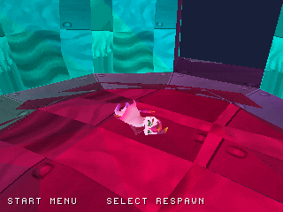
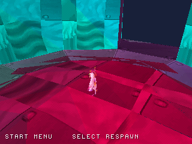
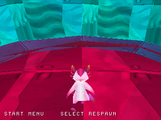

# Personaggio: correzione della deformazione dello scheletro

L'intervento precedente sul rendering lasciava il personaggio deformato.
La causa principale era nella conversione delle animazioni: le curve Euler
venivano composte con assi fissi invece dell'ordine intrinseco Z-X-Y presente
nei dati recuperati. Nel bacino questo introduceva una differenza di circa
**113,6°** rispetto al quaternion serializzato nella scena originale.

La conversione ora compone esplicitamente `qZ * qX * qY`. Il quaternion del
bacino coincide con il riferimento originale entro 0,001° e tutte le 65 pose
dei quattro clip sono state rigenerate. Il recupero dello scheletro è inoltre
fissato al renderer `level2:5571`, evitando che l'ordine di caricamento delle
scene scelga un'altra istanza. La rigenerazione è stata ripetuta e produce
gli stessi file byte per byte.

| Prima: scheletro errato | Dopo: stessa telecamera di gioco |
| --- | --- |
|  |  |

Screenshot reali PS1 HLE dello stesso scenario; la fase di animazione al
singolo frame può differire per il diverso costo del rendering.

## Ispezione ravvicinata in gioco



[Rotazione della telecamera in gioco](screenshots/character_rig/gameplay.gif) ·
[Vista laterale](screenshots/character_rig/side.png) ·
[Vista da dietro](screenshots/character_rig/back.png).

Queste catture usano una build separata con telecamera a 420 unità invece di
850. Modello, materiali, animazione Idle e terreno sono quelli del gioco;
la telecamera ruota tramite input del controller e la RAM viene solo letta.
I quattro dischi principali conservano la telecamera normale.
La GIF campiona i frame video reali 1200–1896 ogni sei frame.

Verifiche: riferimento indipendente del quaternion originale, rigenerazione
riproducibile, suite host ASAN/UBSAN, quattro clip in emulazione, quattro lati
del modello, parete inclinata, trampolino, checkpoint separato e percorso
continuo con due reliquie. [Dati e hash](../reports/character_rig_validation.json).

Restano da rifinire shader, alpha degli occhi e transizioni originali.
L'ordinamento PS1 resta approssimato; non è stato eseguito un confronto con
l'eseguibile Unity né certificato il funzionamento su hardware reale.
La stima del port completo resta 29%.

**Prossima milestone:** recuperare e visualizzare la pianta originale del
checkpoint nell'area collegata.

Per rigenerare e verificare lo scheletro:

```sh
python tools/bake_animation.py '/percorso/Zera Myths Awaken_Data'
python tools/test_character_rotations.py
sh tools/run_host_checks.sh
```

Per la build ravvicinata, configurare PSn00bSDK come di consueto e usare una
directory separata con `-DZERA_CHARACTER_CLOSEUP=ON`, poi compilare il target
`iso`. Il test è `tools/scenarios/character_turntable.json`.
