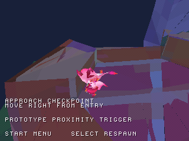
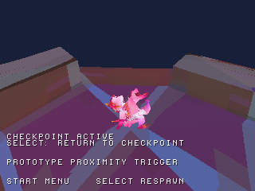

# Preview del checkpoint originale di Dreary Valley

La nuova immagine `build/zera_checkpoint_preview.cue` apre una patch 32×32
unità Unity intorno al respawn del checkpoint originale **6752** di level3.
Contiene 526 triangoli render e 45 triangoli dei collider originali. È un
quarto disco di prova separato: non collega ancora il checkpoint allo spawn
iniziale di Dreary Valley.

Il collegamento è ora disponibile **nel disco principale level3**, con le due
raccolte conservate: [checkpoint collegato](CONNECTED_CHECKPOINT.md). Questa
pagina descrive la prova separata, che rimane disponibile.

Il checkpoint si attiva camminando nella sua zona. Dopo l'attivazione, Select
e Respawn nel menu riportano il personaggio al suo punto originale e impostano
la direzione orizzontale della telecamera recuperata dall'originale. Lo stato
rimane attivo durante questi respawn; Return to title lo azzera e una nuova
partita parte senza checkpoint. Anche il codice di recupero da caduta usa lo
stesso punto; questo caso è verificato nei test host.

| Ingresso della prova | Dopo il ritorno al checkpoint |
| --- | --- |
|  |  |

Catture reali della stessa esecuzione in emulazione. Le posizioni e la camera
differiscono perché mostrano l'ingresso e il successivo respawn.

## Prova rapida

1. Aprire `zera_checkpoint_preview.cue`, con il BIN omonimo accanto.
2. Confermare Explore con Croce e camminare verso destra dal punto di ingresso.
   L'HUD passa a `CHECKPOINT ACTIVE` vicino al checkpoint.
3. Proseguire oltre la zona, poi premere Select: il personaggio torna al checkpoint.
4. Per ripetere la passeggiata, L1 ricentra la camera. Provare anche Start,
   Respawn e Croce, quindi Return to title per azzerare lo stato.

## Dati originali e adattamenti

Spawn originale Unity: `(27.0513153, 21.4159991, 22.2426147)`, riferimento
`_Checkpoint (1)/_SpawnPoint`. Il trigger serializzato è nella stessa X/Z,
con Y=21.4459991. La conversione verifica gli hash di level3 e dell'assembly
contro il recupero della progressione prima di usare questi dati.

Nella patch, lo spawn quantizzato è `(0,-2,0)`: il primo aggiornamento del
movimento lo appoggia al collider a quota 0. La direzione della camera è 1447
unità angolari PS1, derivata dalla posizione del suo target originale.

Sono ancora adattamenti provvisori:

- Ingresso della prova 400 unità PS1 a sinistra del checkpoint, appoggiato al
  terreno recuperato: non è uno spawn originale del livello.
- Attivazione a personaggio a terra, raggio X/Z 160 e tolleranza verticale 80.
  Sostituisce temporaneamente l'interazione con Kiwi. Pianta, frutto, Kiwi e
  relative animazioni/eventi non sono portati in questa preview; la zona è
  indicata dall'HUD.
- Telecamera orbitale esistente: viene ripristinata la direzione orizzontale,
  non l'intera posa originale, né le sue transizioni.
- Stato soltanto nella sessione. Non è un salvataggio su memory card e non
  introduce la persistenza di reliquie o altri oggetti in quest'area.

Il tentativo di estrarre un'area di raggio 96 raggiungeva 10.689 triangoli,
oltre il limite prudente di 6.000 del convertitore. L'esplorazione automatica
a piedi non ha trovato un collegamento al checkpoint con le collisioni attuali;
non è una prova che nessun percorso con altre abilità esista. L'estrazione
ampia è rimasta fuori dal checkout; il limite non è stato alzato.

## Verifiche

Suite host con AddressSanitizer e UndefinedBehaviorSanitizer: ingresso dal
punto di prova, attivazione singola, inattività in pausa/in aria, coordinate
estreme, cambio di checkpoint, annullamento velocità/scatto al respawn, caduta,
ripristino dello spawn e azzeramento della sessione.

Emulazione PCSX-ReARMed `c8816799b50388e61cfe237fe2cdbb7d8175f20a`, HLE,
interpreter/software GPU: **1.750 frame** con soli comandi del controller e
letture della RAM. Verificati attivazione 6752, allontanamento, ritorno con
Select, ritorno dal menu, direzione camera 1447, azzeramento al titolo e nuova
partita. Zero errori CD osservati. Nessuna scrittura della RAM o teletrasporto
del collaudo. Non è una verifica su BIOS reale o hardware.

Il binario occupa circa 760 KB fra testo, dati e BSS secondo la toolchain;
la misura non comprende tutte le riserve BIOS/stack e non certifica prestazioni.
Le altre tre immagini restano compilabili. Le regressioni native del salto
libero e della raccolta 3/3 sono controllate separatamente.

[Configurazione e provenienza](../previews/checkpoint/reports/checkpoint_config.json) ·
[Evidenze native](../reports/checkpoint_validation.json)

## Riprodurre

```sh
python tools/convert_world.py "/percorso/Zera Myths Awaken_Data" --scene level3 --checkpoint 6752 --radius 16 --output-root previews/checkpoint
python tools/prepare_checkpoint_preview.py
python tools/prepare_checkpoint_preview.py --check
sh tools/run_host_checks.sh
cmake --preset default
cmake --build build --parallel 4
python tools/capture_libretro.py /percorso/pcsx_rearmed_libretro.so build/zera_checkpoint_preview.cue build/checkpoint-preview tools/scenarios/checkpoint_preview.json
python tools/check_checkpoint_capture.py build/checkpoint-preview
```

Il port completo resta in lavorazione; questa prova non aumenta automaticamente
la stima provvisoria del 29%.
