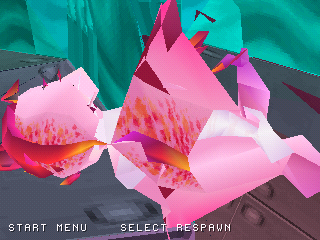
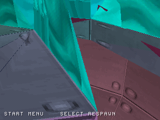
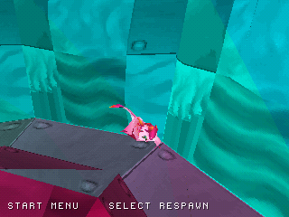

# Clear view when the camera is too close to the mascot

When an obstruction pulls the camera too close, Zera's model can fill the
screen from inside its own geometry. The renderer now temporarily hides the
mascot below **320 world units** of camera distance and restores it at **400**.
The separate thresholds preserve the current visibility state between those
values, preventing small distance changes from repeatedly hiding/showing it.
These distances are provisional PS1 presentation tuning.

| Previous close view | Same position/camera, protected view |
| --- | --- |
|  |  |

Actual emulator captures at video frame 1300 share exactly the same player
position, yaw, camera height and **camera distance 152**. The protection changes
mascot rendering only. Movement, collision, facing, animation and audio continue;
the character becomes visible again as clearance returns. The view is still
constrained by the terrain obstruction, but is no longer filled by the mascot.

The native wall scenario records **20 hidden close-camera samples** and
**11 restored clear-camera samples**. The dedicated mascot scenario also checks
that the mascot remains visible at normal distances while covering idle, run,
jump and glide, with a grounded ending and no automatic respawn.
[Samples, source commits and binary hashes](screenshots/close_camera/verification.json).

Host tests exercise both exact boundaries, negative/near distances, restoration
and 100 repeated small oscillations around each threshold. The native run passes
all previous camera, movement, audio, trial, respawn and level3 checks.
[Native workflow](https://github.com/Dynamon91/Zera-PS1-project/actions/runs/40780601668).
Game source: `498bd0e22c04893859389fc6059f9061a53b8983`.
This is HLE smoke coverage, not hardware or original-Unity fidelity certification.

## Resuming an extracted checkpoint

The package builder also replaces an already-present nested native ZIP once when
`--native-artifact` is supplied. Previously, repackaging an extracted WIP could
emit two archive entries with the same name. Tests now cover an older nested
archive and a supplied build located inside the source tree; the resulting
checkpoint passes full SHA-256 and unique-entry verification.

The complete WIP remains at the provisional **29%**. Original level progression,
persistent saves and complete collision/performance work remain unfinished.
