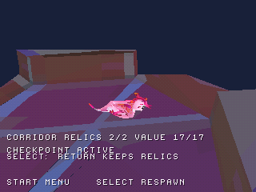
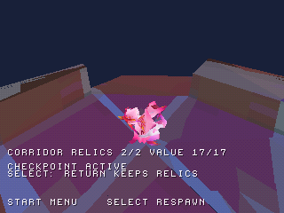

# Checkpoint collegato al percorso delle due reliquie

Nel disco `zera_level3_preview.cue` si può ora partire dallo spawn originale,
raccogliere le reliquie 6606 e 6898 e raggiungere il checkpoint originale **6752**
senza respawn automatici. Select e Respawn dal menu riportano al checkpoint
mantenendo **2 raccolte e valore 17**. Return to title azzera checkpoint e
raccolte; una nuova partita riparte dallo spawn iniziale.

L'attivazione resta provvisoria: vicinanza a terra, raggio 160 e tolleranza
verticale 80. Pianta, frutto, animazioni e interazione originale con Kiwi non
sono ancora integrati. Il riscontro è fornito dall'HUD `CHECKPOINT ACTIVE`.
Il suono di attivazione riusa l'effetto UI, non il suono originale della pianta.

## Preview e immagini reali

[Preview animata del ritorno con Select](screenshots/connected_checkpoint/gameplay.gif).
Mostra la funzione di respawn del gioco; il collaudo invia comandi del
controller e legge lo stato, senza scrivere la RAM.

| Attivazione dopo le due raccolte | Ritorno al checkpoint |
| --- | --- |
|  |  |

Le immagini provengono dalla stessa esecuzione. La GIF è una seconda esecuzione
continua validata con lo stesso BIN e gli stessi comandi; non un montaggio delle immagini.

## Percorso

Dopo le [due raccolte](TWO_CORRIDOR_RELICS.md), portarsi verso X=0,Z=-6473;
tornare lungo il tratto centrale fino a Z=-5000. Procedere verso X=1000,
saltando vicino a X=350 per superare il dislivello. Poi procedere lungo Z
negativo mantenendo X=1000: saltare vicino a Z=-6200 e arrivare a Z=-7101.
Spostarsi verso X=1356 fino all'attivazione del checkpoint. Le coordinate
sono visibili in Diagnostics; le direzioni dipendono dall'orientamento camera.

Non sono stati aggiunti terreno o teletrasporti di collaudo. La taratura di
salto, movimento e volumi resta provvisoria, e gli hazard originali sono assenti:
è un percorso dimostrato nel port, non una certificazione del gameplay Unity.

## Spawn e camera

Il punto serializzato originale corrisponde a **(1356,-115,-7101)** nella mappa
principale. Al primo aggiornamento il personaggio si appoggia al collider a
quota -113. La direzione della camera è **1447**, ricavata dalla differenza
delle posizioni originali prima dell'arrotondamento: ora è indipendente
dall'origine della patch. Le vecchie approssimazioni 1446/1449 dipendevano dalla
quantizzazione delle coordinate nelle due aree.

Dopo il respawn l'orbita automatica attende 30 aggiornamenti prima di poter
correggere di nuovo la vista; i comandi camera restano disponibili. Distanza,
inclinazione, transizioni e orientamento del personaggio non riproducono ancora
l'intera posa originale.

## Verifiche e limiti

- Suite host con AddressSanitizer e UndefinedBehaviorSanitizer: percorso dallo
  spawn, quattro salti, due raccolte, checkpoint, respawn e recupero da caduta.
- Emulazione PCSX-ReARMed HLE interpreter/software GPU: **11.200 frame**,
  attivazione 6752 dopo le due reliquie, ritorno con Select, allontanamento,
  ritorno dal menu, valore 17 conservato, azzeramento al titolo e nuova partita.
  Zero respawn automatici ed errori CD osservati nel percorso nativo.
- Ripristino della direzione camera originale adattata e attivazione unica;
  il recupero da caduta è collaudato nei test host, non in questo scenario nativo.
- Regressioni degli altri scenari esistenti, incluso il checkpoint separato.

Non è un salvataggio su memory card. Il livello completo, i comportamenti
originali mancanti, frame rate, BIOS reale e hardware restano da verificare.
[Evidenze e hash](../reports/connected_checkpoint_validation.json).

```sh
python tools/prepare_checkpoint_preview.py --area level3
python tools/prepare_checkpoint_preview.py --area level3 --check
sh tools/run_host_checks.sh
cmake --build build --parallel 4
python tools/capture_libretro.py /percorso/pcsx_rearmed_libretro.so build/zera_level3_preview.cue build/connected-checkpoint tools/scenarios/connected_checkpoint.json
python tools/check_connected_checkpoint.py build/connected-checkpoint
```

**Prossima milestone:** recuperare e visualizzare la pianta originale del
checkpoint nell'area collegata, prima di ricostruire l'interazione con Kiwi.
