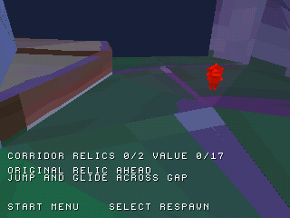
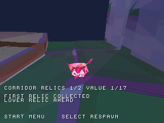

# Prima reliquia originale del corridoio

La preview `zera_level3_preview.cue` consente ora di raccogliere la reliquia
originale **6606**, valore **1**, nella posizione convertita `(-49,-148,-3794)`.
Nella build corrente è attiva anche la [seconda reliquia inferiore](TWO_CORRIDOR_RELICS.md),
valore 16. Il totale delle due raccolte abilitate è 2/2, valore 17: non indica
il completamento di Dreary Valley o delle raccolte originali del livello.

Il modello proviene dal corpo `Relic` del componente originale: 105 vertici
ricompattati, 206 triangoli, materiale rosso/arancio originale. Posizione Y e
trasformazione sono conservate: il centro dell'oggetto si trova 56 unità PS1
sopra il collider alla X/Z quantizzata, senza essere abbassato artificialmente.
Illuminazione delle facce e posa sono statiche; shader riflettente, flare,
particelle, homing e animazione originale restano da portare.

## Percorso e screenshot

Dal punto iniziale, ricentrare con L1 e procedere lungo Z negativo. Dopo circa
Z=-1400, spostarsi verso X=400. Saltare vicino a Z=-2100 e tenere Croce per
planare verso la piattaforma; dopo Z=-3200 rientrare verso X=-49 e proseguire.
Il percorso diretto senza salto cade nel vuoto: non è stato aggiunto terreno
per evitare il passaggio. Movimento, salto e planata restano adattamenti PS1
con taratura provvisoria, non una replica certificata del controller Unity.

La prova automatica gira prima la camera con R2 per inquadrare il percorso e
usa le direzioni coerenti con quell'orientamento. Legge lo stato per cambiare
input; non scrive la RAM e non teletrasporta il personaggio.

| Avvicinamento alla reliquia | Dopo la raccolta |
| --- | --- |
|  |  |

Catture della stessa esecuzione in emulazione. La seconda viene acquisita 15
frame dopo il rilevamento della raccolta per mostrare lo stato già renderizzato.
Camera e personaggio si spostano tra le immagini: non è un confronto pixel a pixel.

## Verifiche

- Suite host con AddressSanitizer e UndefinedBehaviorSanitizer: percorso dallo
  spawn con salto/planata, raccolta singola, pausa, respawn e azzeramento.
- Modello: conteggi, indici, facce e colori verificati; posizione, valore e
  riferimenti del modello confrontati con i recuperi originali.
- Emulazione PCSX-ReARMed HLE interpreter/software GPU: **4.500 frame**,
  scenario della prima raccolta con valore 1, un solo evento sonoro di pickup, nessun respawn
  automatico e nessun errore CD osservato. Select conserva il progresso;
  Return to title e una nuova partita lo azzerano.
- Regressioni separate su corridoio, parete inclinata, salto libero, checkpoint
  e percorso delle tre reliquie del trampolino.

I volumi di raccolta restano provvisori: raggio 44 e tolleranza verticale 64
rispetto ai piedi+32, come nella preview trampolino. Non sono un recupero dei
trigger/homing originali. Non c'è persistenza su memory card. Frame rate, BIOS
reale e hardware non sono certificati.

[Evidenze native e hash](../reports/corridor_relic_validation.json) ·
[Modello originale](../previews/level3/reports/relic_models.json) ·
[Posizione e valore](../previews/level3/reports/corridor_relic_layout.json)

## Riprodurre

```sh
python tools/convert_relic_models.py "/percorso/Zera Myths Awaken_Data" --components 6606 6898 --output-root previews/level3
python tools/prepare_corridor_relic.py
python tools/prepare_corridor_relic.py --check
sh tools/run_host_checks.sh
cmake --preset default
cmake --build build --parallel 4
python tools/capture_libretro.py /percorso/pcsx_rearmed_libretro.so build/zera_level3_preview.cue build/corridor-relic-preview tools/scenarios/corridor_relic.json
python tools/check_corridor_relic_capture.py build/corridor-relic-preview
```

Il [checkpoint 6752 è ora collegato](CONNECTED_CHECKPOINT.md).
**Prossima milestone:** recuperare e visualizzare la sua pianta originale.
