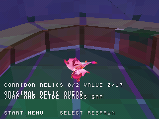
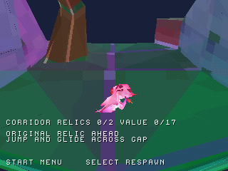

# Primo tratto continuo oltre la patch iniziale

La preview `zera_level3_preview.cue` include ora un corridoio di terreno
originale con limiti Unity relativi allo spawn: X da -24 a +24, Z da -96 a +16.
Il raggio massimo 96 serve al contenitore dei dati; **non** indica una patch
quadrata 192×192. La regione effettiva è 48×112 unità originali.

Contiene 918 triangoli prima della suddivisione per rendering, 2.760 triangoli
render e mantiene il limite di conversione di 6.000. I materiali e le posizioni
provengono dall'originale. Non è stato aggiunto terreno inventato per collegare
le zone. La memoria testo+dati+BSS misurata è circa 1,12 MB; non comprende tutte
le riserve BIOS/stack e non certifica le prestazioni.

## Percorso dimostrato

Partendo dallo spawn, il controller ricentra la telecamera e cammina indietro
lungo Z fino a **(0,-16,-2000)**. Sono 720 unità PS1 oltre il vecchio confine
a Z=-1280. Il personaggio finisce a terra sul collider originale, senza respawn
automatici, teletrasporti del collaudo o scritture della RAM. La prova dura
2.400 frame video in PCSX-ReARMed HLE interpreter/software GPU.

Il feedback legge la posizione e rilascia le direzioni all'arrivo: non modifica
lo stato del gioco. Nessun errore CD osservato. [Evidenze e hash](../reports/corridor_validation.json).

| Spawn | Oltre il vecchio confine |
| --- | --- |
|  |  |

Catture reali della stessa prova con controller, all'ingresso e alla destinazione.

## Cosa manca

È dimostrato solo questo tratto di 2.000 unità, non l'intera regione estratta
nel test di base. Il [collegamento al primo checkpoint](CONNECTED_CHECKPOINT.md)
è ora verificato separatamente, dopo le due raccolte. Le tre reliquie che ricadono
nella regione sono censite nell'audit. La prima sul percorso inferiore,
componente 6606, valore 1, posizione PS1 `(-49,-148,-3794)`, è ora attiva e
[raggiunta con salto e planata](CORRIDOR_RELIC.md). Anche la successiva 6898 è
ora [raccolta nello stesso percorso](TWO_CORRIDOR_RELICS.md), valore totale 17.
La terza reliquia nella regione resta inattiva.
Le raccolte su piani alti richiedono percorsi e
abilità ancora da integrare. Lava, nemici e progressione completa restano assenti.

Non sono certificati frame rate, BIOS reale o hardware: l'estrazione più ampia
e le query per triangolo richiedono ulteriori misure e ottimizzazioni.

## Riprodurre

```sh
python tools/convert_world.py "/percorso/Zera Myths Awaken_Data" --scene level3 --radius 96 --bounds -24 24 -96 16 --output-root previews/level3
python tools/audit_preview_collectibles.py
sh tools/run_host_checks.sh
cmake --build build --parallel 4
python tools/capture_libretro.py /percorso/pcsx_rearmed_libretro.so build/zera_level3_preview.cue build/corridor-preview tools/scenarios/level3_corridor.json
python tools/check_corridor_capture.py build/corridor-preview
```

**Prossima milestone:** recuperare e visualizzare la pianta originale del
checkpoint collegato. La stima complessiva resta provvisoria.
