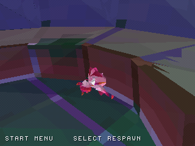

# Level3 support on original layered surfaces

The separate level3 preview now selects player support from **55 bounded
triangles recovered from the original walkable colliders**. It chooses the
highest surface at or below the player's current step/landing ceiling. It no
longer uses the single-valued diagnostic heightfield for player support, and
source floors are no longer capped at spawn+6 Unity units. The established
level2 disc retains its previous heightfield behavior.

Floor coordinates are integer PS1 world units, positive Y up. Closed X/Z bounds
reject unrelated triangles before 64-bit barycentric interpolation. Vertical
triangles do not provide support. Grounded steps search up to 48 units above
the previous feet position; airborne landing queries search up to 8 units above
it and retain the existing downward-crossing landing check.

| Actual recovered X/Z | Original projected collider heights | Previous grid result | Support selected below ceiling 48 |
| --- | --- | ---: | ---: |
| (360, -440) | 0, 266 | 266 | 0 |
| (550, 0) | 0, 261 | 196 | 0 |

The second grid result interpolates a height that is not either collider surface
at that point. These are support-query examples, not verified travel routes.
Sampling a 40-unit grid across X/Z from -1200 to 1200 finds 48 points with more
than one distinct projected surface height. [Raw source-data checks](../previews/level3/reports/floor_support_validation.json).

Host tests cover stacked surfaces, reversed winding, edges, slopes, missing
support, vertical triangles and large short-coordinate triangles. Player tests
check a jump that stays below the upper floor and a fall that lands on it.
Level3 integration tests check the original overlapping surfaces and retain
500-unit walks in four directions. Address/undefined-behavior checks pass.

| Previous level3 build | New support implementation |
| --- | --- |
|  |  |

Actual emulator captures at video frame 1599 show the same grounded final
position **(500, 0, 0)**, with zero automatic respawns. They verify that the
existing walk still works; they do not demonstrate traversal beneath an upper
floor. [Binary hashes and final samples](screenshots/floors/comparison.json).
The [native workflow](https://github.com/Dynamon91/Zera-PS1-project/actions/runs/40744562217)
also passes the established level2 camera, audio, respawn, trial and exploration
checks. Native game source: `7cdeb50ee99c84becbfb2be1607fc88f15a63882`.

Conservative vertical wall proxies remain and can block routes that support
queries alone permit. This is point support, not a swept character capsule:
head/ceiling collisions, complete wall geometry and robust slope handling still
need work. Original collectible interactions and persistence remain unported.
Completion stays at the provisional **29%**.
