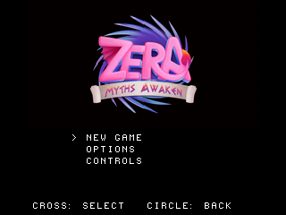
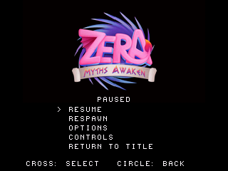

# Avvio e menu collegati alla partita

Questa pagina descrive la milestone precedente, con ingresso a Dreary Valley.
Per il menu ampliato e Cosmic Core vedere [CAMPAIGN_ENTRY.md](CAMPAIGN_ENTRY.md).

Il nuovo disco `zera_gameplay.cue` avvia il filmato originale del logo con il suo
sonoro, passa al titolo con la texture originale di Zera Myths Awaken e riproduce
il brano originale **Glass Arp**. Nuova partita apre il percorso di Dreary Valley
con caricamento a settori, due reliquie e checkpoint. È un passo verso il gioco
completo, non l'integrazione dell'intera campagna.



[Preview con audio registrato nell'emulatore](screenshots/frontend/startup.mp4) ·
[GIF dell'avvio](screenshots/frontend/startup.gif) ·
[Movimento, pausa e ripresa](screenshots/frontend/pause_resume.gif)

## Comandi e comportamento

- Il logo termina automaticamente; un pulsante permette di saltarlo.
- Il titolo offre Nuova partita, Opzioni e Comandi.
- Start apre la pausa. Riprendi oppure Start/Cerchio riprendono la partita.
- Il menu di pausa offre anche Respawn, Opzioni, Comandi e Ritorna al titolo.
- In pausa e nei relativi sottomenu si fermano fisica, animazioni e raccolte.
- Select o Respawn ritornano al checkpoint attivo conservando le reliquie.
- Nuova partita azzera reliquie e checkpoint. Opzioni conserva nella sessione
  l'impostazione audio acceso/spento; non esiste ancora un salvataggio su memory card.

Il brano del titolo si ferma all'avvio della partita e riparte tornando al titolo.
Gli effetti originali di menu, salto, atterraggio, dash, planata e raccolta sono
residenti nella SPU: non richiedono letture CD durante i caricamenti della mappa.
La musica dei livelli non è ancora integrata in questo disco.



## Provenienza e adattamenti

Il filmato è il VideoClip `logo` di `sharedassets0.assets:77`, la texture del
titolo è `sharedassets0.assets:18` e Glass Arp è `sharedassets1.assets:25`.
Riferimenti, hash sorgente, sezioni della banca e qualità della conversione sono
in `previews/frontend/reports/frontend_assets.json`; il recupero della logica
originale è in `reports/frontend_recovery.json`.

Per questa prima implementazione il logo è ricampionato a **160×90, 8 fps,
16 colori per fotogramma**, ingrandito a 320×180 mantenendo il rapporto 16:9.
L'audio originale è ridotto a mono 22.050 Hz SPU ADPCM. La palette cambia a ogni
fotogramma; il video completo è precaricato prima di iniziare il sonoro.
Glass Arp è completo e ripete al confine del file: non è stato recuperato un
punto di loop musicale originale. Le altre sequenze narrative non sono ancora
state integrate. Il layout del menu è un adattamento PS1, non la ricostruzione
completa degli eventi e delle schermate Unity.

La memoria di precaricamento del logo viene riutilizzata dalla geometria del
mondo quando parte la partita. Il titolo resta in una zona VRAM separata da
framebuffer, font e texture del personaggio. Un difetto trovato nelle prime prove
causava fotogrammi vuoti nei menu: le primitive del logo ora mantengono il bit
di disegno verso l'area di visualizzazione quando cambiano pagina texture.
Le catture finali verificano la presenza del titolo in entrambi i buffer.

## Prove locali

- Test host con AddressSanitizer/UndefinedBehaviorSanitizer: transizioni dei
  menu, pausa/ripresa, opzioni, respawn e ritorno al titolo, oltre alla suite esistente.
- Banca FRONT.DAT: verifica di tutte le sezioni, hash originali, palette,
  formato ADPCM, fine/loop dei campioni, catalogo e limiti della memoria SPU.
- Otto scenari nativi con PCSX-ReARMed HLE: avvio automatico con ripetizioni
  della musica, salto del logo, flusso di menu/pausa/opzioni, quattro regressioni
  di camminata e percorso delle due reliquie fino al checkpoint.
- In pausa vengono confrontati posizione, velocità, stato, contatore dei tick,
  animazione e progressi. Audio silenziato verificato anche sul PCM registrato;
  presenza del suono controllata dopo la riattivazione.
- Modello, animazioni e materiali di Zera conservano i dati già corretti; gli
  hash sono confrontati anche con il pacchetto giocabile precedente.
- Build Release: **1.399.396 byte** di sezioni statiche, entro il budget di
  1.572.864 byte. Il controllo non certifica frame rate o hardware reale.

I risultati e gli hash della build sono in `reports/frontend_validation.json`.
Le verifiche sono locali; il workflow GitHub è aggiornato ma non eseguito da remoto.

## Lavoro ancora necessario

Mancano la scena animata originale del menu, le altre schermate/opzioni, il
caricamento dei salvataggi, i crediti e l'avvio corretto della campagna in Cosmic
Core. Il disco apre ancora Dreary Valley per preservare il percorso verificato.
Interazioni complete, NPC, nemici, musica dei livelli, altri percorsi e campagna
rimangono nel piano del [port completo](PORT_COMPLETO.md).

**Prossima milestone:** ricostruire le altre schermate e opzioni del menu originale
e collegare l'ingresso della campagna a Cosmic Core.

## Ricompilazione

Con PSn00bSDK 0.24 configurato:

```sh
python3 tools/check_frontend_assets.py --data '/percorso/Zera Myths Awaken_Data'
sh tools/run_host_checks.sh
cmake -S . -B build -DCMAKE_BUILD_TYPE=Release -DZERA_FULL_FRONTEND=ON
cmake --build build --target iso_game
python3 tools/capture_libretro.py /percorso/pcsx_rearmed_libretro.so build/zera_gameplay.cue build/frontend-flow tools/scenarios/frontend_flow.json
python3 tools/check_frontend_capture.py build/frontend-flow --kind flow
```

La banca già convertita è inclusa nei sorgenti distribuiti. Per rigenerarla dai
file originali servono anche UnityPy, NumPy, Pillow, ffmpeg e un compilatore C host:
`python3 tools/prepare_frontend_assets.py '/percorso/Zera Myths Awaken_Data'`.
