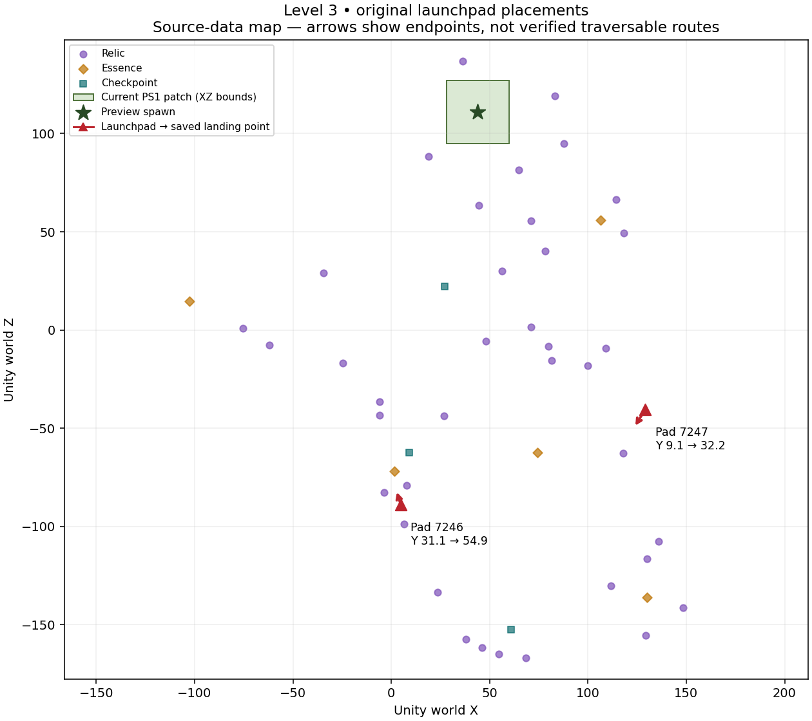

# Original launchpads: recovery checkpoint

Nine `NewZera.LaunchPad` components have been recovered from the original compiled Unity build: level2 **2**, level3 **2**, level4 **1**, level5 **1**, level6 **3**. Each has its original world transform, landing point, companion (`kiwiPoint`) transform, layer mask, travel parameters and source hashes in [launchpad_recovery.json](../reports/launchpad_recovery.json).

This page records the source-recovery milestone. A subsequent [playable launchpad prototype](LAUNCH_GAMEPLAY.md) now integrates component 7246 in a separate original-area PS1 disc, with manual Triangle activation. Full companion/Somersault behavior remains unported.



This is a source-coordinate map, not an emulator screenshot. Arrows connect serialized start and landing positions; they do not establish a walkable route or collision clearance. Both level3 pads lie outside the current radius-16 preview. They do not explain how to reach the elevated relics immediately around the preview spawn; that route still needs investigation.

| Level3 component | Original start X, Y, Z | Saved landing X, Y, Z | travelTime | travelSpeed |
|---|---|---|---:|---:|
| 7246 | 4.781, 31.058, −88.747 | 2.468, 54.881, −81.284 | 2.159257 | 1.75 |
| 7247 | 129.151, 9.079, −40.387 | 123.410, 32.154, −49.741 | 2.111952 | 1.75 |

## Behavior recovered from compiled methods

The report preserves the decoded IL of `LaunchPad.Update`, `Reset`, `LaunchMotion`, `CancelLaunch`, its constructor and the launch coroutine's `MoveNext`, with original offsets and metadata tokens. The assembly hash binds this evidence to the source build.

`Update` checks player distance within 10 Unity units of the pad to arrange the companion. The launch condition checks distance within 3 units of `kiwiPoint`, the player's `Somersault` state, and the pad's `launched` flag. Full companion behavior and player state transitions still require porting.

The coroutine switches the player rigidbody to kinematic movement and plays the original `boing` sound. For normalized traversal time `u`, it calculates:

```
position = Lerp(pad_world_position, landingPoint, u)
position.y += u * (u - 1) * 0.5 * gravity.y * travelTime * travelTime
u += fixedDeltaTime / travelTime * travelSpeed
```

`travelTime` is therefore an arc parameter, not by itself the elapsed flight duration. Ignoring fixed-step rounding, normalized traversal takes `travelTime / travelSpeed`. The coroutine loops while `u < 1`; there is no final forced endpoint snap in this method. The subsequent playable prototype recovers serialized PhysicsManager gravity Y = −30; see its linked configuration and source hash. The serialized `glideLockRange` is 0.5 for all nine components; its wider player-state effects are not implemented by this audit.

`landingPoint` is a world-space `Vector3`, not a Transform reference. `kiwiPoint` is a Transform reference; all nine references resolve. The 40-byte serialized payload matches the six public fields after the 32-byte component header. Private runtime fields are not decoded as serialized parameters. Field signatures and referenced Unity types are checked against `Assembly-CSharp.dll` before reading payloads.

## Reproduction and validation

```
python3 tools/recover_launchpads.py /path/to/Zera\ Myths\ Awaken_Data
python3 tools/check_launchpad_recovery.py
python3 tools/plot_launchpads.py
```

Extraction dependencies: UnityPy 1.25.4, dnfile, dncil, numpy and scipy. The plot requires matplotlib; the committed-data validator uses only Python's standard library. The extraction was repeated and produced byte-identical JSON. Validation cross-checks original source hashes against the earlier progression recovery, all nine reference targets and transforms, scene counts, positive time/speed values, and the IL sequences behind the arc and time-step formula. CI runs the validator on every push.

Next integration work: connect the dedicated area to the rest of the level and port the companion/Somersault launch condition. The separate prototype now tests landing and interruption behavior in native emulation. Overall full-port estimate stays **29%**; this recovery alone does not make another original level playable.
