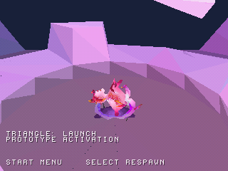
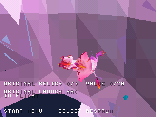
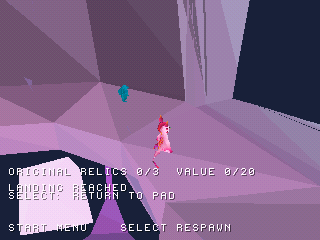
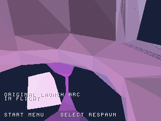
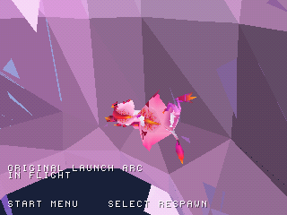

# Playable original launchpad area

The WIP now has a third PS1 disc: `build/zera_launchpad_preview.cue`.
It opens the original level3 area around LaunchPad **7246**, including the
trampoline model, its upper landing platform and surrounding terrain. Press
**Cross** at the title, then **Triangle** near the pad to launch. **Start** pauses
flight; **Select** cancels it and returns to the starting pad. D-pad movement,
jump/glide, R1 dash and camera controls remain available for exploration.

The launch follows the recovered original arc to its authored destination.
Triangle is a prototype replacement for the original Somersault/companion
activation. The companion itself, its behavior and original launch animations
are not implemented; the existing character and jump/land effects are used.

| Before launch | Flight | After landing |
| --- | --- | --- |
|  |  |  |

These are actual frames from one native emulator scenario, showing stages of the
same playable action. They are not generated illustrations or a comparison with
the original Windows renderer.

## Original data and PS1 adaptation

The extraction square is 32×32 original Unity units centered on the launchpad at
(4.781326, 31.058001, −88.747391). Its saved destination is
(2.467587, 54.881252, −81.283722). The patch has 21 render instances,
1,350 globally clipped source triangles, 3,322 cell-partitioned render triangles,
and 201 uncapped floor triangles. The dedicated converter includes the original
trampoline's child models and the landing platform's MeshCollider as well as the
level terrain. It does not fabricate a connecting level corridor.

The source `PhysicsManager` in `globalgamemanagers`, path ID 10, stores gravity
Y = **−30**. This serialized setting and the recovered pad's `travelTime`
2.159257411956787 and `travelSpeed` 1.75 generate the integer parameters in
[launch_config.json](../previews/launchpad/reports/launch_config.json).
The managed assembly contains no `set_gravity` member reference; this does not
exclude effects from other native/managed components not audited here.

Flight evaluates the recovered parabola at nominal 30 simulation updates/s,
using Q16 normalized time and FP=256 positions. It takes 38 updates, clamps to the
exact quantized endpoint and selects the original supporting floor. The final
endpoint clamp is a deliberate adaptation: the original coroutine loops while
normalized time is below 1 without a final endpoint assignment. Integer path
checks differ by less than 2 FP units (1/128 world unit) from a floating-point
reference using the quantized constants.

The landing point is on the recovered upper platform at PS1 floor Y=1895;
independent host tests retain the grounded position for 120 additional updates.
During the kinematic flight, walking/jump/dash input does not override the path.
The camera follows launch height directly to keep Zera in frame during the fast climb. Pause does not advance traversal. Select cancels the flight state before resetting
player and camera, allowing another launch.

The lower terrain and landing platform remain usable for exploration, with the
existing conservative wall proxies and point-floor support. Ceiling/capsule
collision, original hazards, companion logic, full level flow and progression
remain incomplete. Nominal simulation time is not a claim of 30 FPS on hardware.

## Validation and reproduction

[Native verification](screenshots/launchpad/verification.json) records the exact
source revision and BIN hash. The controller-only 2,200-video-frame test checks
two completed launches, one mid-flight Select cancellation, paused position/time,
trajectory samples and a stable grounded ending, with zero automatic respawns.
The capture tool reads emulator RAM for verification and never changes it.
The two earlier playable discs also retain their full native regression scenarios.

```sh
python3 tools/convert_world.py "/path/to/Zera Myths Awaken_Data" --scene level3 --launchpad 7246 --radius 16 --output-root previews/launchpad
python3 tools/prepare_launch_preview.py "/path/to/Zera Myths Awaken_Data"
python3 tools/check_launch_assets.py
sh tools/run_host_checks.sh
cmake --preset default
cmake --build build
```

The existing level3 start headers reproduce byte-for-byte with the extended
converter. Native validation uses the pinned PCSX-ReARMed HLE interpreter and
software GPU; retail BIOS and physical PS1 testing remain pending.

Extract `native/Zera_PS1_WIP09_Native.zip` from the full checkpoint, then open
`build/zera_launchpad_preview.cue` with its BIN beside it. The other discs remain
`build/zera_wip09.cue` (level2) and `build/zera_level3_preview.cue` (level3 start).

## Flight-camera correction

The first native run passed the trajectory and landing checks, but inspection
of the real flight image showed the ordinary camera smoothing lagged below Zera.
The launch-only vertical follow now tracks the player directly. The native check
also compares camera and player height throughout the sampled flight.

| Before launch-camera correction | After correction |
| --- | --- |
|  |  |

Same controller scenario and video-frame index; source and timing details are
recorded in [the comparison evidence](screenshots/launch_camera/verification.json).

Verified native source: `23e35b41246c41ac7f1d3b6cdab0e08013a5a173`; [successful native run](https://github.com/Dynamon91/Zera-PS1-project/actions/runs/40785184613). The final scenario recorded **24 matching trajectory/camera samples**, **4 frozen pause samples**, **2 completed flights** and **1 cancellation**, ending grounded without automatic respawns.

The launchpad disc now also includes [original-position relic collection](RELIC_COLLECTION.md), with provisional pickup/material and session-only progress.
