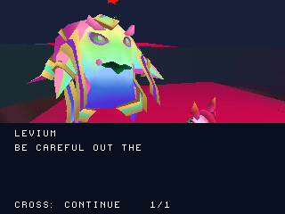

# Primo incontro con Levium in Cosmic Core

Il nuovo disco collega una prima conversazione originale al percorso giocabile
di Cosmic Core. Si raggiunge Levium camminando dallo spawn, compare il comando
**Triangle: Talk to Levium**, e Zera cammina fino al punto di conversazione
autore. Cross mostra il testo e passa alla battuta successiva. Al termine tornano
i controlli; parlando di nuovo si ottiene **“Be careful out there.”**.


[Preview della conversazione nell'emulatore](screenshots/levium/conversation.gif)

Le sei battute sono recuperate da `level2:6279`, classe `NewZera.NPCDialogue`,
con ordine, parole e nome del personaggio originali. La paginazione le mantiene
in sei schermate; la frase successiva usa una settima schermata separata.
Il callback originale `NewDialogue` e il flag `alreadyTalked` sono adattati nello
stato di sessione: il testo successivo diventa disponibile completando la prima
conversazione. Non viene attribuito uno sblocco di livello che il callback non contiene.



## Modello e inquadratura

Levium usa il renderer originale `level2:5551`, mesh `sharedassets2.assets:82`:
**1.080 vertici, 906 triangoli, 45 ossa**. I vertici sono calcolati dalla posa
serializzata, dai bind pose e da tutti i pesi originali. La verifica indipendente
ricostruisce le trasformazioni dai quaternion senza usare lo stesso percorso
SciPy dell'esportatore. Materiali, colori dei vertici, occhi e superfici
Doublesided sono conservati con gli adattamenti PS1 indicati nel report.

Questo primo inserimento usa la **posa statica originale**. Le animazioni
Idle/Talking non sono ancora riprodotte: restano la prossima milestone.
Gli occhi mantengono la texture originale 64×64 con trasparenza cutout e ripetizione
UV; sfumature alpha e shader Unity non sono equivalenti. I dati già corretti di
Zera e delle reliquie restano invariati e protetti dal controllo degli hash.

La camera usa posizione e rotazione originali della conversazione. Nelle prime
prove sono stati trovati e corretti un errore di segno nella conversione verticale
e la sovrapposizione del pannello diagnostico al volto: durante il dialogo la
parte superiore dell'immagine resta libera. L'overlay del testo è adattato allo
schermo PS1 e non riproduce ancora la pergamena animata originale.

## Interazione e stato

Il trigger originale è una capsula ruotata: l'asse locale Y risulta orizzontale
nella scena. Sono conservati posizione, raggio ed estremi trasformati. Il contatto
usa la capsula provvisoria del giocatore PS1; richiede il personaggio a terra e
fuori dal dash. Il movimento al punto di conversazione passa dalla fisica e dai
caricamenti dei settori, senza teletrasporto.

La posizione orizzontale autore è `(4816,206)`. Zera si assesta sul terreno
recuperato intorno a Y=-425; il marker originale è a Y=-410. Il port usa i piedi
sul terreno anziché imporre quell'altezza al modello. La capsula fisica del corpo
di Levium, i danni al personaggio e gli altri comportamenti NPC non sono ancora
integrati. Solo questo personaggio e questa conversazione sono abilitati.

Start apre la pausa anche durante il dialogo, conservando battuta e avanzamento
del testo. Riprendere continua la stessa conversazione. Select/Respawn tornano
allo spawn conservando il fatto di aver parlato; una nuova partita lo azzera.
Non è ancora un salvataggio su memory card.

Il clip assegnato a queste battute nell'originale si chiama `Silence`. È stato
anche decodificato e misurato: ampiezza massima 1 su scala PCM16, senza parlato
udibile. Non è stata inventata una voce. La musica di Cosmic Core e la sequenza
narrativa iniziale restano da integrare.

## Verifiche locali

- Recupero deterministico confrontato con i file originali; hash di scene,
  mesh, materiali e assembly, testo completo e callback di fine conversazione.
- Verifica dei pesi, indici, topologia, materiali e trasformazioni dello scheletro;
  controllo indipendente di tutti i vertici convertiti e dei quaternion sorgente.
- Test host ASan/UBSan sul percorso continuo, trigger, restrizioni in salto/dash,
  avvicinamento, battute complete e testo successivo.
- Due prove native: prima conversazione e ripetizione, respawn e nuova partita;
  pausa e ripresa nel mezzo del dialogo. Solo input del controller e lettura della RAM.
- Quattro regressioni native nella build aggiornata: terreno di Cosmic Core,
  salto/planata, cambio settore in aria, menu e impostazioni.
- Le otto prove precedenti di Dreary Valley restano riferite al suo disco
  verificato, incluso nel pacchetto. Il relativo eseguibile ricompilato è identico
  byte per byte; non sono presentate come nuove esecuzioni di quei test.
- Build Release: **1.512.288 byte** di sezioni statiche, entro il budget di
  1.572.864. Le prove sono PCSX-ReARMed HLE locali, non certificazione hardware
  o del frame rate. Il workflow GitHub è aggiornato ma non avviato da remoto.

Rapporti: `previews/levium/reports/levium.json`, `voice_check.json` e
`reports/levium_validation.json`. Il [port completo](PORT_COMPLETO.md) resta in
lavorazione: gli altri NPC, tutorial, animazioni, musica, progressione e salvataggi
non sono resi completi da questa conversazione.

**Prossima milestone:** animazioni originali Idle/Talking di Levium, con gli
stessi controlli su rig, materiali e resa in gioco.

## Riproduzione

```sh
python3 tools/recover_levium.py '/percorso/Zera Myths Awaken_Data' --check
python3 tools/check_levium.py --data '/percorso/Zera Myths Awaken_Data'
sh tools/run_host_checks.sh
cmake -S . -B build -DCMAKE_BUILD_TYPE=Release -DZERA_CAMPAIGN_ENTRY=ON -DZERA_LEVIUM_DIALOGUE=ON
cmake --build build --target iso_campaign
python3 tools/capture_libretro.py /percorso/pcsx_rearmed_libretro.so build/zera_campaign.cue build/levium_conversation tools/scenarios/levium_conversation.json
python3 tools/check_levium_capture.py build/levium_conversation --kind conversation
```
