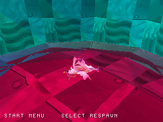
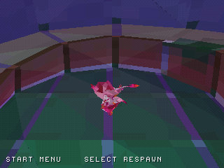
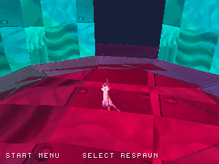
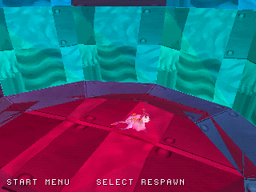

# Playable Zera mascot: materials and skin packing

The playable character remains the original **Zera mascot** recovered from the
project's source assets. This update restores the original eye and spotted-body
textures and uses the original per-corner vertex colors with PS1 Gouraud shading,
instead of averaging every face to one flat color. The change applies to both
the established level2 disc and the separate level3 terrain preview.

| Before, level2 | Updated mascot, level2 |
| --- | --- |
|  |  |

| Before, level3 | Updated mascot, level3 |
| --- | --- |
|  |  |

These are actual emulator captures from the same scripted start scenarios.
Animation phase can differ as renderer timing changes. They are not a
frame-matched comparison against the original Unity executable.

## Source mascot details

The level2 SkinnedMeshRenderer at path ID 5571 uses resources.assets mesh 314
and original Body, Spots and Eyes materials. The **96 spot faces** now sample
`zeratexture` (object 153), and the **16 eye faces** sample `Eye` (object 236).
The 806-triangle geometry and all four original baked clips are retained.

The atlas keeps the eye texture at 64×64, with wrapped padding for the source
UVs outside 0–1. Spots are reduced from 256×256 to 128×128 using nearest-neighbor
sampling. A shared indexed palette reserves color zero for transparency; eye
alpha uses a 128 cutout threshold. Texture-window commands isolate the two
128×128 regions, and the atlas/palette occupy separate VRAM from terrain and
font data. Equal-depth draw order favors spot and eye layers over the body.

A second correction separates two coincident packed positions with different
joint influences. Mesh indices and baked animation now share a skinning-aware
mapping: **412 animated positions instead of 411**, while preserving 806 faces.
Per-corner UVs/colors retain their original seams independently of that mapping.

[Material provenance and conversion limits](../reports/mascot_materials.json) ·
[Shared vertex mapping](../assets/character_packing.json).

## Native verification

The [2,200-video-frame controller-only scenario](https://github.com/Dynamon91/Zera-PS1-project/actions/runs/40749689934)
observes Idle, Run, Jump and Glide clips, including actual jumping and gliding
player states, and finishes grounded with zero automatic respawns. All existing
wall/camera, audio, respawn, trial and both terrain checks also pass.
Host tests validate material face counts, texture/palette transparency, draw-order
coverage, vertex bounds and the updated animation arrays.

| Alternate view | Glide |
| --- | --- |
|  |  |

Source game code tested: `2e20f8b592078ab27d4d4c2737a36cfa23871c1b`.
[Raw capture and binary hash](screenshots/mascot/verification.json).

This is a PS1 material adaptation. Soft alpha blending, the original custom
Unity shader/lighting and the authored animation transition graph remain
unreproduced; painter ordering and conservative projection can still produce
artifacts. Full-port completion remains the provisional **29%**.

## Reproduce

With the original Data folder and the existing source sidecars:

```sh
python3 tools/convert_character.py
python3 tools/bake_animation.py "/path/to/Zera Myths Awaken_Data"
python3 tools/convert_mascot_materials.py "/path/to/Zera Myths Awaken_Data"
sh tools/run_host_checks.sh
```

Open `build/zera_wip09.cue` or `build/zera_level3_preview.cue` after extracting the
nested native ZIP from the updated WIP package.
