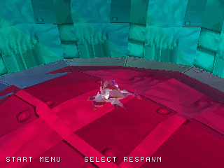
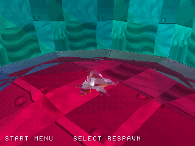
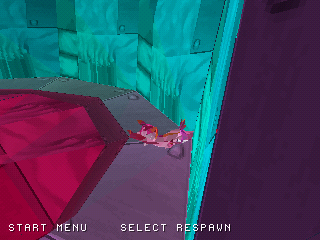
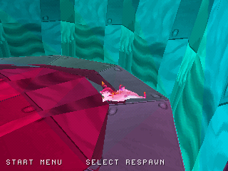
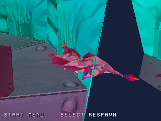
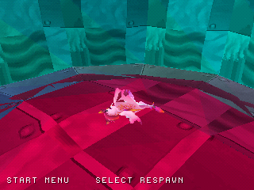
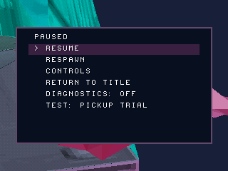
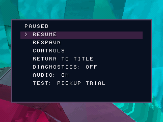

# Confronto nativo WIP08 / sorgente WIP09

Sorgente compilato: `3a1cb17944009760aaf210f756666d0e5732aced`. Catture reali PCSX-ReARMed, HLE BIOS,
interprete CPU e GPU software. Stesso percorso e stessi istanti di cattura.
Questo confronto verifica un caso della telecamera; non aggiunge livelli al gioco.

| Frame | Prima: WIP08 | Dopo: nuovo build WIP09 |
| --- | --- | --- |
| 359 |  |  |
| 700 |  |  |
| 1300 |  |  |
| 1599 |  |  |

Le differenze di posizione possono derivare dal nuovo comportamento della camera.
Le immagini non dimostrano prestazioni o compatibilità hardware.
Il build e tutte le catture sono scaricabili dagli artifact della relativa esecuzione
**Native PS1 preview** in GitHub Actions. Il vecchio disco in `disc/` resta WIP08.
Il pacchetto WIP09 source mantiene il suo stato esplicito: non sostituisce quel disco.

## Camera da fermo: prima e dopo la ricerca laterale

Catture dello stesso scenario al frame 1410; i metadati dei due build sono conservati nelle rispettive cartelle.

| WIP09 prima della ricerca laterale | WIP09 con ricerca laterale |
| --- | --- |
|  |  |

La ricerca si attiva solo da fermo, con pausa e controlli manuali prioritari. Non garantisce una vista libera in ogni angolo.
