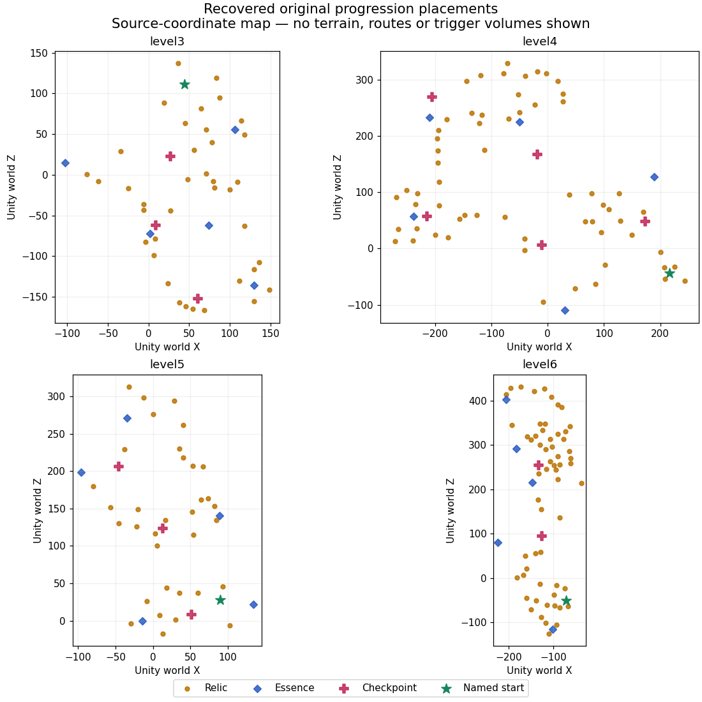

# Recovered original progression data

The original compiled Unity scenes contain **193 relic components, 20 essence
components and 13 checkpoints**. This checkpoint recovers their original world
transforms, hierarchy names, enabled state, collectible values, and all 26
checkpoint spawn/camera target references. It adds conversion data and tooling;
these objects are not yet active in the PS1 runtime.

| Serialized scene | Relics | Essences | Checkpoints | Relic value sum |
| --- | ---: | ---: | ---: | ---: |
| level2 | 1 | 0 | 0 | 1 |
| level3 | 38 | 5 | 3 | 339 |
| level4 | 61 | 5 | 5 | 391 |
| level5 | 34 | 5 | 3 | 263 |
| level6 | 59 | 5 | 2 | 448 |

These are serialized components and value sums, not level-completion totals.
Runtime-created objects, container contents, events, saving and runtime activation
still need reconstruction. The currently ported area is **level2**. Its single
relic is explicitly named **TEMP RELIC TO STOP 100% IN THIS LEVEL** in the source;
it is retained in the recovery report and has not been added as a playable goal.
The optional six-token PS1 trial remains a separate new test layout.



This is a top-down map of recovered Unity X/Z coordinates, not an emulator
screenshot. It shows no terrain or verified travel routes. Stars mark objects
named `_StartSpawnPoint`, including `_StartSpawnPoint (1)` in level3. Actual
runtime spawn selection still needs verification. Each checkpoint's two original
references are resolved independently; camera targets are retained as data.

## Reproduce and validate

From the project root, with UnityPy 1.25.4, dnfile, NumPy and SciPy installed:

```sh
python3 tools/recover_progression.py "/path/to/Zera Myths Awaken_Data"
python3 tools/check_progression_recovery.py
# Optional visualization, requires Matplotlib:
python3 tools/plot_progression.py
```

[Machine-readable recovery](../reports/progression_recovery.json) records source
file SHA-256 hashes and each serialized component's raw-byte hash and path IDs.
The decoder checks Unity 2019.4.18f1 and the managed field order/type before
reading custom data after the aligned MonoBehaviour header. Relic and essence
values come from the serialized integer field, not from object-name guesses.
Named relic denominations independently agree with the decoded values. Transform
matrices compose original rotation, scale, translation and parent hierarchy.
The report uses original Unity units; conversion to PS1 coordinates and ground
height has not been applied.

A [bounded level3 terrain preview](LEVEL3.md) now exists with height-aware
original collider support. The next content step is connecting traversable
terrain to original placements, followed by collection/respawn rules and
persistent save reconstruction. The
playable build remains the latest verified WIP09, with the camera broad-phase
optimization. Project completion remains the provisional **29%**.
