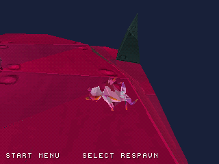
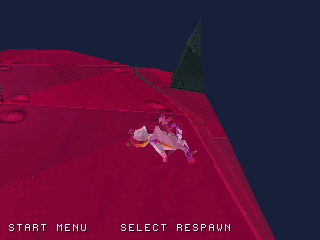
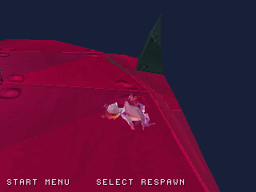

# Rendering and camera performance checkpoints

The clipper reuses signed endpoint distances across adjacent polygon edges.
Each active clipping plane now evaluates each vertex once rather than twice.
The near plane transforms only Z; side planes transform X/Z or Y/Z rather than
all three axes. World-space interpolation, UV rounding and plane order are retained.
Fully accepted/rejected triangles still use the existing fast paths.

A frozen previous clipper is compared against the new implementation in 50,000
seeded cases with varied matrices, translations, geometry and UVs: 16,202 clipped
cases, 33,540 rejected cases, and identical output counts, positions and UVs in all
cases. Address/undefined-behavior sanitizer checks pass.

| Same controller scenario | Before | After |
| --- | ---: | ---: |
| Active interval, frames 330–4799 | 13.869 updates/s | 13.923 updates/s |
| Stationary interval, frames 3000–4799 | 15.008 updates/s | 15.008 updates/s |
| Final position | (2207, -241, 0) | (2207, -241, 0) |

This is a small scenario-level change, not evidence that the 30 Hz target is
met. The route's time spent at each location changes with simulation pacing.
The stationary interval keeps the same world position and shows no improvement.
Rates count simulation updates over emulated 60 Hz video frames, not host runtime
or physical-console FPS. Raw interval counts and binary/source hashes are in
[screenshots/performance/comparison.json](screenshots/performance/comparison.json).

| Previous build | Optimized build |
| --- | --- |
|  |  |

These are actual emulator captures at frame 4799, with the same grounded final
position. They document retained rendering; animation phase can differ.

New native source: `967a963041c01478f04d97005fa5e1dcc22703f9`.
[Native build and all capture checks](https://github.com/Dynamon91/Zera-PS1-project/actions/runs/40710270129)
passed, including wall/camera, audio mute, automatic fall respawn, trial and
expanded-world exploration. Completion stays at the provisional **29%**: this
checkpoint adds no original level content or progression.

## Camera ray broad phase

Camera obstruction checks visit 576 wall proxies for each camera view query.
The new implementation rejects disjoint closed segment bounds in X, Z and Y
before computing the exact 64-bit intersection. Endpoint contacts, collinear
rays, vertical entry and zero-length rays retain the exact narrow-phase test.

The optimized implementation matches the frozen previous implementation in
100,000 seeded ray/wall cases, including forced collinear, vertical and point
rays: all Q12 hit fractions agree, including 6,750 intersections. Existing camera
edge-case tests and the address/undefined-behavior sanitizer checks also pass.

| Same controller scenario | Before camera filter | After camera filter |
| --- | ---: | ---: |
| Active interval, frames 330–4799 | 13.923 updates/s | 13.990 updates/s |
| Stationary interval, frames 3000–4799 | 15.008 updates/s | 15.008 updates/s |
| Final position | (2207, -241, 0) | (2207, -241, 0) |

The route gain is small; the stationary interval is unchanged. The 30 Hz target
remains unmet. These rates describe the emulated scenario, not hardware FPS.
[Raw interval counts and hashes](screenshots/camera_performance/comparison.json).

| Before camera filter | After camera filter |
| --- | --- |
|  |  |

Actual frame-4799 emulator captures retain the same final grounded position;
animation phases can differ. Source `943c20653a6301b34cdaad2c9891e95017541d51`
passed [native checks](https://github.com/Dynamon91/Zera-PS1-project/actions/runs/40738639949)
for walls/camera, mute/restoration, automatic fall respawn, trial and expanded
world exploration. Completion remains the provisional **29%**.

