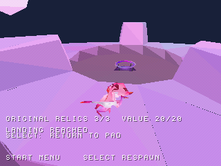

# Raccolta delle reliquie

**Tre reliquie originali raccolte: 3/3, valore totale 20.**

Il giro verificato usa due lanci del trampolino e un salto per raggiungere la
reliquia inferiore. Il respawn conserva i progressi della sessione; il ritorno
al titolo li azzera. Volume di raccolta e aspetto restano provvisori.

| Prima | Dopo |
| --- | --- |
|  |  |

Screenshot reali della prova in emulazione. Salvataggio su memory card ancora in lavorazione.
