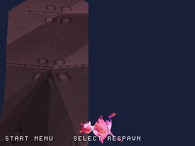
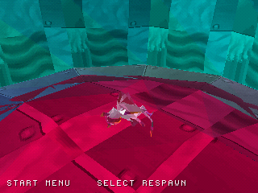

# Terrain-relative fall recovery

Native source: `0c8e4c27657922a787963efbc07f79f7fa92c131`.

The safety plane is now 700 units below the lowest valid heightfield sample
(-4077 in this recovered patch), instead of -700 relative to spawn.
Host tests check landing on valid ground at -800 and reject missing samples
when deriving the limit. Native input-only testing checks the off-map path:
minimum sampled Y **-3297**, one automatic respawn, then player at spawn and
camera restored to distance 850 / height 0. Movement is released using read-only Y feedback after the fall starts. No game RAM is edited.

| Falling | Recovered at spawn |
| --- | --- |
|  |  |

This changes a provisional safety rule; it does not add new level geometry or
claim fidelity to the original game's death/checkpoint rules. HLE validation
does not establish retail-BIOS or hardware compatibility.
