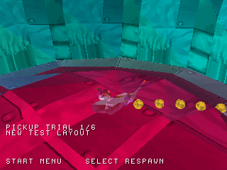
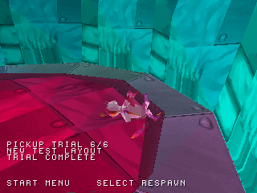

# Screenshot e stato del progetto

Le immagini di riferimento sotto sono catture reali WIP08 a 320×240.
Il confronto WIP08/WIP09 usa anche nuove catture native, nella pagina dedicata. Non sono immagini generate
né prove visive dei cambiamenti successivi della telecamera.

## Prima e dopo durante lo stesso test

| Prima: raccolta a 1/6 | Dopo: raccolta completata a 6/6 |
| --- | --- |
|  |  |

È lo stesso build WIP08 in due momenti diversi. Le posizioni e le regole di questa
prova sono contenuto sperimentale PS1, non progressione originale recuperata.
Percorso: `tools/scenarios/pickup_preview.json`; dati: `preview/capture.json`.

## Movimento e pareti — riferimento prima degli aggiornamenti

| Partenza, frame 359 | Vicino alla parete, frame 1300 |
| --- | --- |
|  |  |

Queste immagini documentano l'area di prova e i limiti visibili della camera.
Non sono un confronto tra due versioni. Per quello, usare il
[confronto nativo WIP08/WIP09](NATIVE_COMPARISON.md), pubblicato solo dopo la nuova cattura.

## Stato completo

| Elemento | Stato verificabile |
| --- | --- |
| Disco incluso in `disc/` | WIP08, con catture HLE esistenti |
| Pacchetto sorgente | WIP09 source, con manifest SHA-256 e riferimento al commit |
| Camera più recente | Test host e nuovo build nativo: scenario pareti completato per 1.600 frame in HLE |
| Nuove screenshot | Nuove catture WIP09 pubblicate con sorgente e hash del disco; vedi il confronto nativo |
| Porting completo | Stima provvisoria circa 28%, dettagli in [PROGRESS.md](../PROGRESS.md) |
| Livelli e progressione | Ancora una piccola porzione del mondo; progressione originale non portata |

Il workflow nativo conserva un artifact con BIN/CUE, EXE, mappa e catture reali.
I controlli HLE non dimostrano compatibilità con BIOS retail, hardware reale o
prestazioni garantite. Il pacchetto sorgente mantiene il disco WIP08 finché non
si integra esplicitamente un nuovo checkpoint giocabile.
