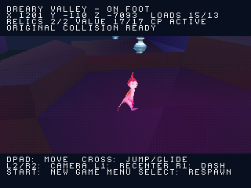
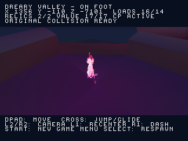

# Reliquie e checkpoint nella Dreary Valley a settori

La camminata con collider originali ora collega le reliquie 6606 e 6898 al
checkpoint 6752: un unico percorso dallo spawn originale, attraverso i settori
caricati da CD, fino alla raccolta **2/2, valore 17** e all'attivazione.





[Preview in gioco: prima raccolta](screenshots/stream_progress/gameplay.gif)

Select ritorna al checkpoint attivo, conserva entrambe le raccolte e ripristina
la direzione originale della camera adattata al sistema di orbita. Senza
checkpoint, Select ritorna allo spawn iniziale e conserva le raccolte. Start
apre il menu: Cross avvia una **nuova partita**, azzerando raccolte e checkpoint.
Non è ancora un menu di pausa con ripresa.

Le coordinate sono rigenerate dalle trasformazioni originali recuperate,
con la stessa origine della banca fisica e scala 80. Le reliquie sono a
`(-49,-146,-3794)` e `(-980,-468,-6473)`. Lo spawn del checkpoint è
`(1356,-112,-7101)` e si assesta sul terreno a Y=-110; la camera usa yaw 1447.
Il modello corretto del personaggio e le animazioni restano quelli già verificati.
I modelli delle reliquie mantengono la geometria e i colori base recuperati.

## Verifiche locali

- Test host con ASan/UBSan: percorso continuo sulle collisioni originali,
  raccolta senza duplicati, checkpoint, ritorno dopo caduta, ricaricamenti
  che conservano il giocatore e azzeramento dello stato di sessione.
- Emulazione PCSX-ReARMed HLE: 24.000 frame, solo input del controller;
  raccolta 2/2, checkpoint raggiunto dopo 13 caricamenti dei settori fisici,
  Select con valore 17 conservato, nuova partita con stato azzerato.
- Regressioni native: terreno, parete/camera, salto/planata, cambio settore
  durante il salto. Nessun errore CD o sforamento del buffer grafico nei campioni.
- Build Release; sezioni statiche RAM 1.167.348 byte su budget 1.572.864.
  Questo controllo non certifica prestazioni o funzionamento su hardware reale.

I dati e gli hash sono in `reports/stream_progress_validation.json`.
Il disco precedente rimane disponibile separatamente.

## Limiti

Sono collegate soltanto queste due reliquie e questo checkpoint. Il raggio di
raccolta resta provvisorio; homing, effetti e shader originali non sono riprodotti.
Il checkpoint si attiva per prossimità a terra: l'interazione originale con Kiwi
non è ancora implementata. Lo stato dura nella sessione, senza salvataggio su
memory card. Audio, trampolini, oggetti mobili e progressione completa non sono
ancora integrati in questo disco. Il port completo non è al 100%.

**Prossima milestone:** collegare il trampolino originale al percorso di
Dreary Valley e verificare lancio e atterraggio sulla mappa a settori.

## Riproduzione

```sh
python3 tools/prepare_stream_progress.py --check
sh tools/run_host_checks.sh
cmake -S . -B build -DCMAKE_BUILD_TYPE=Release -DZERA_STREAM_WALK=ON
cmake --build build --target iso_walk
python3 tools/capture_libretro.py /percorso/pcsx_rearmed_libretro.so build/zera_stream_walk.cue build/stream-walk-progress tools/scenarios/stream_walk_progress.json
python3 tools/check_stream_progress_capture.py build/stream-walk-progress
```
