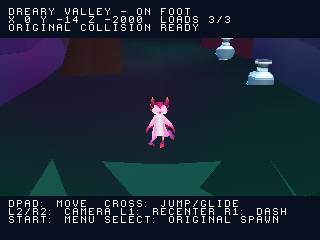
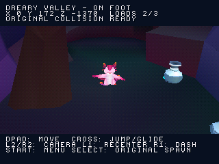

# Dreary Valley: camminata con caricamento a settori

Zera ora usa i collider originali di Dreary Valley nella mappa caricata dal CD,
in un nuovo disco separato dall'atlante a volo libero e dalle vecchie preview.
Il percorso verificato arriva dallo spawn originale a `(0,-14,-2000)` senza
respawn, con due attraversamenti di confine e tre caricamenti dei collider.
Il modello, le animazioni e i materiali del personaggio conservano gli stessi
dati della correzione dello scheletro già verificata.



[Preview della camminata e del caricamento](screenshots/stream_walk/gameplay.gif) ·
[Salto/planata attraverso un confine](screenshots/stream_walk/airborne.gif).
Sono fotogrammi reali PS1 HLE, con input del controller e RAM solo letta.
Le GIF conservano le schermate di caricamento effettive.

## Come provarlo

Aprire `build/zera_stream_walk.cue` con il relativo BIN e premere Croce.

- Direzioni: camminare; Croce: saltare, tenere Croce per planare.
- R1: scatto; L2/R2: ruotare la telecamera; L1: ricentrarla.
- Select: tornare allo spawn originale.
- Start: tornare alla schermata iniziale; Croce avvia nuovamente dallo spawn.

Il menu di questa build propone solo Dreary Valley. La selezione delle altre
cinque mappe rimane nell'atlante a volo libero.

## Verifiche del movimento

| Caso | Risultato verificato |
| --- | --- |
| Camminata | Dallo spawn a Z=-2000; terreno seguito, nessun respawn e nessun errore CD |
| Parete inclinata originale | Arresto a X=536, mentre viene mantenuto Destra; animazione Idle quando bloccato |
| Camera vicino alla parete | Retrazione e occultamento del modello quando troppo vicina; vista laterale e modello ripristinati a input rilasciato |
| Salto/planata | Salita, discesa e atterraggio; quota massima 156, terreno allo spawn a quota 3 |
| Cambio settore in aria | A Z=-1290 i nuovi collider sono pronti con stato Jump, Y=152 e velocità verticale +7; la planata prosegue e termina a terra |



Il test host usa anche i dati originali per i percorsi e verifica che il
ricaricamento non modifichi posizione, velocità o stato del giocatore.
Controlla un errore di lettura seguito da retry, query con coordinate globali
oltre i 16 bit e contatto della testa con un soffitto sintetico traslato.
Il soffitto è un test host: non viene dichiarata una prova nativa di urto
contro un soffitto originale.

Sono passati quattro scenari nativi della camminata e sette regressioni
dell'atlante. La suite host usa AddressSanitizer/UndefinedBehaviorSanitizer.
Le due banche dati estratte dal disco coincidono byte per byte con i sorgenti.
[Prove e hash](../reports/stream_walk_validation.json).

## Dati e scala

Sono recuperati **10.144 triangoli sorgente** dei MeshCollider solidi attivi,
ripartiti in **723 settori**, con massimo 4.035 triangoli residenti in una
finestra 5×5 e buffer di 4.096. Le collisioni sono in unità fisiche 80/Unity,
come nelle vecchie preview. La grafica dell'atlante usa 40/Unity: posizione e
modello vengono convertiti con scala uniforme, senza cambiare lo scheletro
o la taratura del movimento. Origine e matrici sono controllate sull'originale.

Il refilling avviene a simulazione ferma e conserva lo stato del personaggio.
I settori grafici seguono la camera; quelli fisici seguono il giocatore.
Le due finestre possono quindi ricaricarsi in momenti diversi. Il buffer CD è
allineato a quattro byte e conserva spazio per header e padding dei settori.

Costo statico dell'eseguibile Release: **1.158.864 byte**, sotto il budget di 1,5 MiB.
Il dato non certifica stack, heap, BIOS o prestazioni su hardware reale.
[Inventario dei collider](../previews/walk/reports/stream_collision.json).

## Limiti di questa milestone

È verificato il primo percorso, non l'attraversamento completo di tutti i 723
settori. Si usano MeshCollider attivi e solidi: Box/SphereCollider, attivazioni
runtime e oggetti mobili richiedono ancora lavoro. Due collider convex usano
la mesh sorgente, senza riprodurre il cooking convesso Unity. Lava e attori
sono esclusi dal recupero; danni e comportamento originali sono da collegare.

Corpo, camera e movimento riusano l'adattamento esistente; non sono una
riproduzione completa della fisica Unity. Texture/shader del mondo e audio
restano incompleti. Le prime due reliquie e il checkpoint sono ora collegati: vedere
[percorso, prove e limiti](STREAMED_PROGRESS.md). Trampolini e progressione
completa restano da collegare; le relative preview precedenti restano disponibili.
Tutte le prove native sono locali con PCSX-ReARMed HLE.

**Prossima milestone:** collegare il trampolino originale al percorso di
Dreary Valley e verificare lancio e atterraggio sulla mappa a settori.

## Riproduzione

Dopo la configurazione PSn00bSDK del progetto:

```sh
python tools/recover_stream_collision.py '/percorso/Zera Myths Awaken_Data'
python tools/check_stream_collision.py --data '/percorso/Zera Myths Awaken_Data'
sh tools/run_host_checks.sh
cmake -S . -B build -DCMAKE_BUILD_TYPE=Release -DZERA_STREAM_WALK=ON
cmake --build build --target iso_walk
```

Senza i dati Unity, il checker controlla comunque l'intera banca binaria e
il catalogo generato. Gli scenari sono `stream_walk_ground`, `stream_walk_wall`,
`stream_walk_jump` e `stream_walk_air_seam` sotto `tools/scenarios/`.
