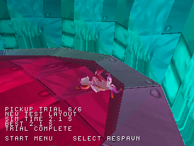
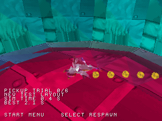

# Pickup trial timer and best run

The optional development trial now displays SIM TIME and BEST. Time counts
simulation updates at a nominal 30 Hz, not wall-clock time or measured FPS.
New native run: **6/6 pickups**, best **2.1 simulation seconds**
(64 ticks). Source: `29736b485c3397c138c70d456dfcf4ab2d018b80`.

| Completed run | Fresh run with best preserved |
| --- | --- |
|  |  |

The 1,650-frame HLE scenario verifies completion, frozen completed time, manual
respawn preserving score/time, restart resetting the timer while preserving best,
and return to title clearing the record. Host tests cover pause freeze and
slower/faster records. No memory-card save is implemented. Placements, scoring
and timing are PS1 test content; this is not original recovered progression.
