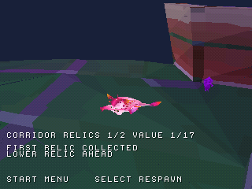
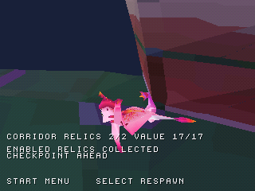

# Due reliquie originali nello stesso percorso

Nel disco `zera_level3_preview.cue` si possono ora raccogliere le reliquie
originali **6606** e **6898**, partendo dallo spawn e attraversando il percorso
inferiore senza respawn automatici: **2/2, valore totale 17**. Questo conteggio
riguarda soltanto le due raccolte abilitate, non il completamento del livello.

| Componente | Valore | Posizione PS1 | Altezza sul collider alla X/Z quantizzata |
| --- | ---: | --- | ---: |
| 6606 | 1 | (-49,-148,-3794) | 56 |
| 6898 | 16 | (-980,-471,-6473) | 103 |

Posizioni e valori sono recuperati dall'originale, senza abbassare gli oggetti
per facilitarne la raccolta. I due corpi originali hanno ciascuno 105 vertici
ricompattati e 206 triangoli: primo materiale rosso/arancio, secondo viola.
La posa e l'illuminazione sono statiche; shader, homing ed effetti originali
restano incompleti. Gli oggetti fuori dal raggio di disegno della patch vengono
esclusi dal rendering, coerentemente con il terreno.

## Preview reale in emulazione

[Apri la breve preview animata GIF](screenshots/corridor_two_relics/gameplay.gif).
È una sequenza continua di frame dell'emulatore intorno alla seconda raccolta,
non un montaggio dei due screenshot. La GIF deriva da un'altra esecuzione
validata degli stessi comandi, con lo stesso BIN. Non è una misura del frame rate.

| Avvicinamento alla seconda reliquia | Seconda raccolta |
| --- | --- |
|  |  |

Le due immagini provengono dalla stessa esecuzione. Dopo la raccolta l'HUD
mostra 2/2 e 17/17, il modello scompare e il suono viene emesso una sola volta
per oggetto. La camera si muove durante il percorso: non è un confronto pixel a pixel.

## Percorso di prova

Usare il [primo percorso con salto e planata](CORRIDOR_RELIC.md) fino alla
reliquia 6606. Proseguire lungo Z negativo, mantenendo X vicino a -49 fino a
circa Z=-5700, poi spostarsi verso X=-980. Vicino a Z=-6300 saltare e continuare
verso la reliquia a Z=-6473. Il secondo salto permette di entrare nel volume
di raccolta alla quota originale dell'oggetto. Con L1 la camera è ricentrata;
le coordinate possono essere visualizzate attivando Diagnostics.

Il collaudo automatico usa R2 per guardare lungo il percorso e adatta le
direzioni del controller a quella vista. Non modifica la RAM del gioco.

## Prove e limiti

- Suite host con AddressSanitizer e UndefinedBehaviorSanitizer: percorso
  completo, due salti, raccolte 1 e 16, blocco dei duplicati, pausa e respawn.
- Modelli: indici, conteggi, colori e riferimento alle posizioni originali.
- Emulazione PCSX-ReARMed HLE interpreter/software GPU: **7.400 frame**,
  due raccolte e due suoni, valore 17, nessun respawn automatico o errore CD.
  Select conserva entrambe; Return to title e la nuova partita le azzerano.
- Regresso separato della prima raccolta e degli altri scenari esistenti:
  corridoio, muro, salto libero, checkpoint e tre reliquie del trampolino.

Volumi di raccolta e taratura del movimento sono provvisori, come nelle
preview precedenti. La terza reliquia alta della regione è ancora inattiva.
Il [checkpoint 6752 è ora collegato al percorso](CONNECTED_CHECKPOINT.md), con
attivazione di prossimità provvisoria. Pianta, interazione Kiwi, nemici, lava e
progressione completa restano da integrare; il checkpoint separato resta una
prova autonoma. Non c'è persistenza su memory
card. Frame rate, BIOS reale e hardware non sono certificati.

[Evidenze native e hash](../reports/two_corridor_relics_validation.json).

```sh
python tools/convert_relic_models.py "/percorso/Zera Myths Awaken_Data" --components 6606 6898 --output-root previews/level3
python tools/prepare_corridor_relic.py
sh tools/run_host_checks.sh
cmake --build build --parallel 4
python tools/capture_libretro.py /percorso/pcsx_rearmed_libretro.so build/zera_level3_preview.cue build/corridor-two-relics tools/scenarios/corridor_two_relics.json
python tools/check_two_corridor_relics.py build/corridor-two-relics
```

**Prossima milestone:** recuperare e visualizzare la pianta originale del
checkpoint nell'area collegata.
