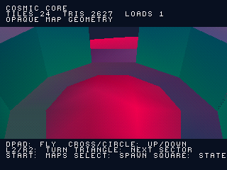
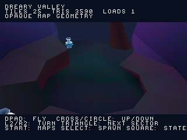
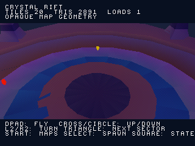
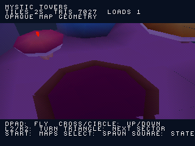
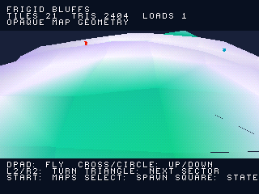
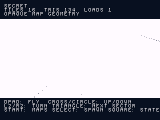

# Mappe originali: atlante PS1 da CD

Aggiornamento: è disponibile una [build separata a piedi di Dreary Valley](STREAMED_WALK.md), con i collider originali caricati a settori. Questo documento descrive l'atlante a volo libero.

Le sei scene del mondo presenti nella build ricevuta sono state convertite
in un atlante esplorabile su PS1. L'estrazione copre l'intera geometria statica
supportata, senza il ritaglio intorno allo spawn usato dalle vecchie preview.
Questo disco serve a controllare le mappe: la navigazione è a volo libero,
con selezione delle scene, e non integra ancora fisica, nemici, progressione
o collegamenti giocabili tra livelli.

| Scena | File originale | Triangoli sorgente supportati | Settori |
| --- | --- | ---: | ---: |
| Cosmic Core | level2 | 58.863 | 550 |
| Dreary Valley | level3 | 41.104 | 723 |
| Crystal Rift | level4 | 58.473 | 787 |
| Mystic Towers | level5 | 39.865 | 495 |
| Frigid Bluffs | level6 | 49.680 | 521 |
| Secret | level7 | 384 | 361 |

Totale: **248.369 triangoli sorgente**, ripartiti in **3.437 settori**.
Splash e menu sono scene di interfaccia separate. Canvas Falls e Coral Deep
compaiono nei gateway, ma non hanno una scena autonoma nel BuildSettings
ricevuto. Secret ha un marker `StartSpawn`; non viene assunto che sia un
livello giocabile con Zera.

## Esplorazione

Aprire `build/zera_world_atlas.cue` con il relativo BIN. Nel menu, Su/Giù
seleziona la mappa e Croce la apre. La telecamera iniziale segue la direzione
del marker originale, arretrata e rialzata per l'ispezione.

- Direzioni: movimento orizzontale libero; Croce/Cerchio: salire/scendere.
- L2/R2: ruotare la visuale; L1: riallineare alla direzione iniziale.
- L3/R3: inclinare la visuale; R1: movimento più rapido.
- Triangolo: visitare il settore successivo della stessa scena.
- Select: tornare al punto di ispezione iniziale; Start: selezione delle mappe.
- Quadrato: alternare geometria opaca iniziale e tutte le geometrie esportate,
  inclusi oggetti disattivati ed effetti trasparenti trattati come superfici.

La vista predefinita esclude effetti trasparenti e materiali a zero alpha:
i loro triangoli sono conservati nei dati e sono ispezionabili nell'altra
modalità. Non riproduce l'aspetto del renderer Unity originale. Le texture
sono campionate nei colori dei vertici; shader, acqua, cubemap, illuminazione,
alpha e skybox richiedono ancora un adattamento dedicato. I materiali con
shader personalizzati vengono classificati dai tag dello shader: le sole
proprietà salvate come `_Mode` non descrivono sempre la trasparenza reale.

## Catture reali

Le immagini seguenti sono fotogrammi dell'emulatore PS1 HLE, ottenuti solo
tramite input del controller. Non sono render Unity o immagini generate.

| Cosmic Core | Dreary Valley |
| --- | --- |
|  |  |

| Crystal Rift | Mystic Towers |
| --- | --- |
|  |  |

| Frigid Bluffs | Secret |
| --- | --- |
|  |  |

[Preview del movimento e del caricamento](screenshots/world_atlas/gameplay.gif).
La GIF conserva anche eventuali schermate di caricamento reali.

## Memoria e copertura verificata

`WORLD.DAT` contiene le geometrie divise in celle di 16 unità Unity. La PS1
carica dal CD una finestra di 5×5 celle, riusando un buffer fisso. Le coordinate
locali a ogni settore evitano di forzare l'intero livello nei 16 bit del GTE.
Il limite residente è calcolato su tutte le posizioni possibili, comprese
quelle con la cella centrale vuota: massimo 9.550 triangoli, buffer di 9.728.
Il costo statico dell'eseguibile è **747.026 byte** (circa 730 KiB); non certifica
stack, BIOS o prestazioni sull'hardware reale. Il rendering conserva un budget
finito di primitive; le prove verificano che le viste catturate non lo esauriscano.

Sono mantenuti tutti i sottomesh triangolari dei MeshRenderer 3D supportati,
compresi gli stati inizialmente disattivati. Attori, mesh con scheletro, HUD,
particelle e gusci del cielo sono esclusi e conteggiati nell'inventario.
Le trasformazioni e gli intervalli dei batch statici sono verificati contro
i file originali. La superficie totale prima e dopo la suddivisione coincide
entro 1e-9 relativo. I frammenti che diventano degeneri con la quantizzazione
sono censiti; la perdita di superficie è inferiore allo 0,001% per scena.

[Inventario, geometrie escluse e provenienza](../previews/atlas/reports/world_atlas.json) ·
[Test PS1, limiti e hash](../reports/world_atlas_validation.json).

Il personaggio corretto rimane nelle build di gameplay precedenti. L'atlante
è un eseguibile separato e non sostituisce quelle build con un volo libero.
La stima complessiva del port resta 29%: l'estrazione delle mappe non equivale
al completamento dei livelli.

**Prossima milestone:** integrare i collider originali nel caricamento a
settori e il movimento del personaggio, partendo da Dreary Valley; quindi
ricostruire i passaggi tra le scene e gli oggetti di gameplay.

## Riprodurre le verifiche

```sh
python tools/recover_world_atlas.py '/percorso/Zera Myths Awaken_Data'
python tools/check_world_atlas.py --data '/percorso/Zera Myths Awaken_Data'
cmake -S . -B build -DZERA_WORLD_ATLAS=ON
cmake --build build --target iso_atlas
```

Richiede la configurazione PSn00bSDK del progetto. Senza i file Unity,
`python tools/check_world_atlas.py` controlla comunque tutti i blocchi binari,
gli hash, le coordinate locali e il limite di residenza. I sei scenari
`atlas_level2.json`–`atlas_level7.json` aprono ogni scena; `atlas_streaming.json`
verifica movimento, ricaricamenti, modalità degli stati e cambio mappa.
